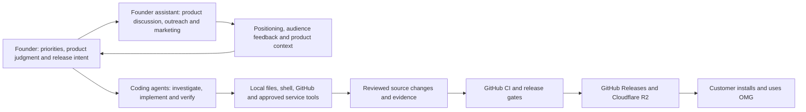
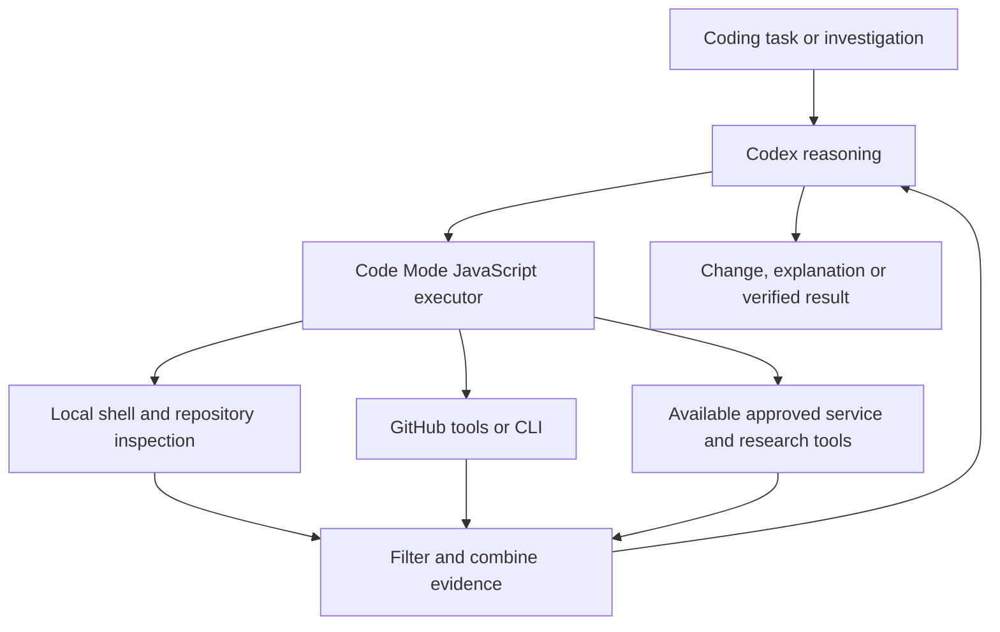
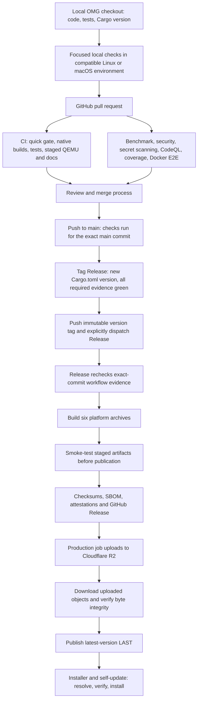
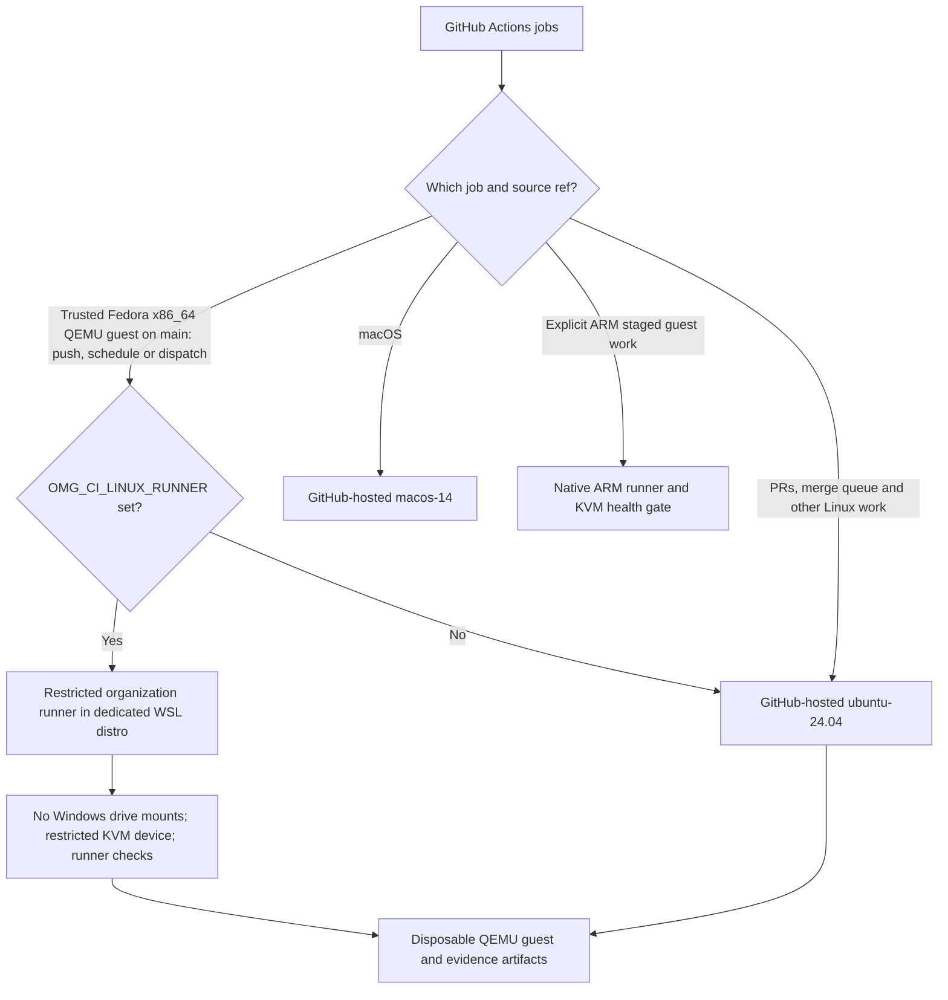
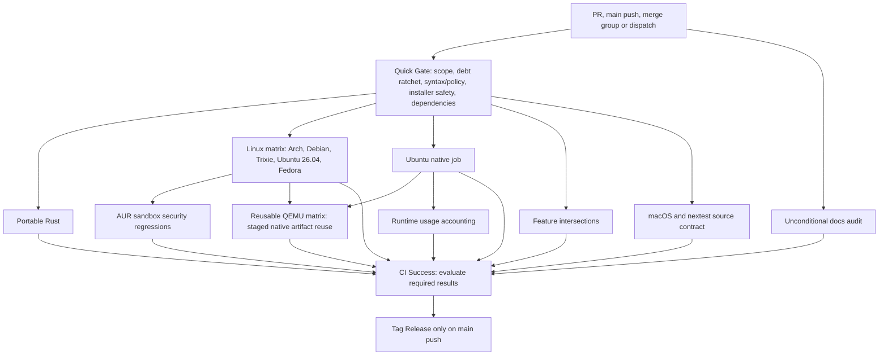
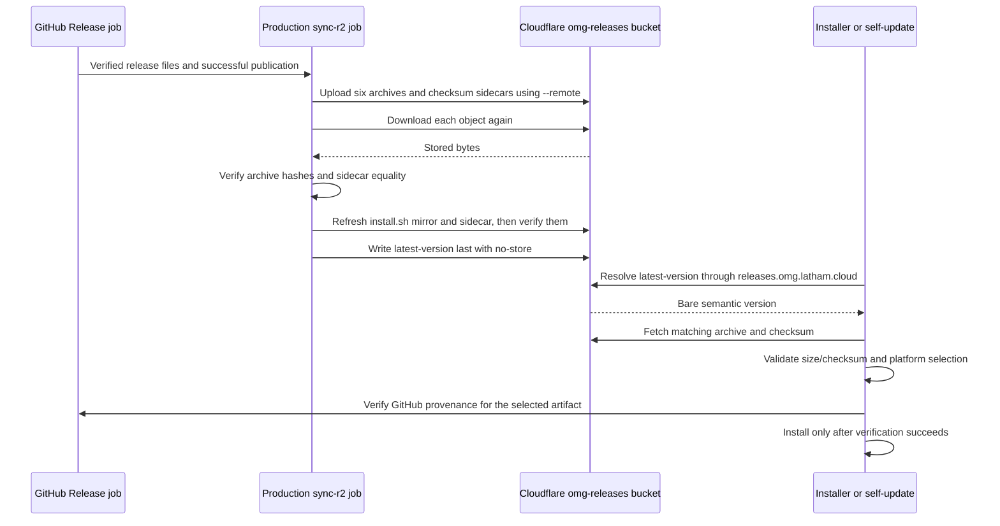
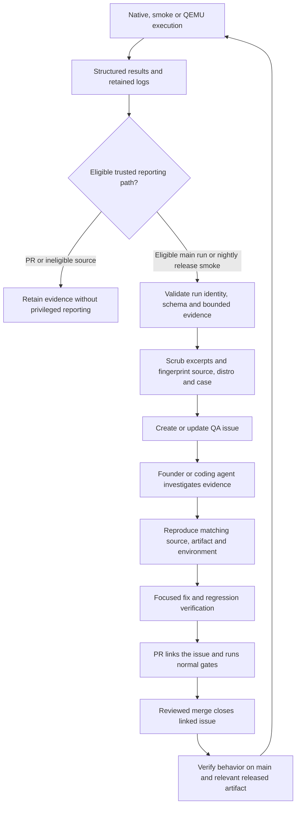

# OMG: product, AI-assisted engineering, CI/CD and Cloudflare delivery

This is a detailed context brief for the founder's **strategy, outreach and marketing assistant**. It explains what OMG is, how the founder uses coding agents and automation to build it, and how changes travel from local development through GitHub validation to Cloudflare delivery. The technical appendix supports product discussions and evidence-based claims; it is not a request to start coding, contact prospects, or alter infrastructure.

Prepared 2026-10-28 from the local checkout at `C:\Users\olen\Documents\Codex\omg`, HEAD `4188acc777b3c8140e2563170c38c1761e8a5c07`. Workflow source was inspected; current GitHub run results, organization settings, secrets, runner health and Cloudflare objects were not queried for this document. Existing unrelated local changes were preserved.

Repository: [omg-cli/omg](https://github.com/omg-cli/omg). The observability dashboard is a separate application and is not part of this release pipeline. The OMG website/API live in the separate [omg-cli/omg-web](https://github.com/omg-cli/omg-web) repository. This pipeline delivers CLI binaries through Cloudflare R2; it does not deploy the website's Workers.

## Founder context: what the product is

OMG brings **system packages, language runtimes, developer tools, project tasks, and vulnerability evidence into one Rust CLI**. Its intended benefit is a consistent developer workflow across supported systems without requiring users to assemble a different set of tools on each machine.

The current README describes Arch, Debian, Ubuntu, Fedora and Apple silicon macOS support, with Windows use through supported Linux distributions in WSL. It is MIT-licensed, local use does not require an account, and telemetry is off by default. These are source-documented product properties, not a new installation audit of every platform.

The product uses platform-specific backends: ALPM on Arch, APT/libapt on Debian and Ubuntu, RPM reads and guarded DNF operations on Fedora, and a policy-gated Homebrew path on macOS. AUR has its own review, dependency, sandbox and archive-inspection path. A consistent CLI does not mean every backend has identical behavior or security capabilities.

The daemon is an optional cache/background-refresh component; it is not the entire product. The README describes package operations and vulnerability scanning without a mandatory running daemon. Native Pi coding-agent version management also exists in `src/runtimes/pi.rs`; that product capability is distinct from using Pi as a developer tool to build OMG.

### Why the engineering system matters to the product

Package-management software can change a user's real system. OMG therefore needs more than unit tests or an attractive CLI demo: it needs evidence about package transactions, distro compatibility, recovery, downloads and provenance. The delivery system is designed to reduce the chance of shipping an artifact that compiles but fails on the intended machine.

| Engineering investment | Product value it supports | What it does not establish by itself |
| --- | --- | --- |
| Native platform builds and ABI-specific artifacts | Compatibility with different package-manager environments | Every distro/version is supported |
| QEMU guests and staged release smoke tests | Behavior checked against real operating-system environments and candidate binaries | Every user machine or every command has been tested |
| Exact-commit release prerequisites | Release decisions tied to the source actually being shipped | An absence of defects or vulnerabilities |
| Checksums and GitHub provenance verification | Integrity and source/workflow identity checks before installation | Formal compliance certification or elimination of supply-chain risk |
| R2 verification before changing latest-version | A failed upload should not advertise an incomplete new release through that marker | Atomic publication across GitHub and Cloudflare |
| Failure evidence and issue deduplication | Reproducible problems become actionable work rather than lost logs | Fully autonomous diagnosis, repairs or merges |
| Local tools plus hosted CI | Fast iteration with independent release checks | Verified cost savings without usage/billing measurements |

### Suggested product description for outreach

> OMG is a Rust developer CLI that brings system packages, language runtimes, developer tools and security evidence into one workflow across supported Linux distributions and Apple silicon macOS. Its release process combines native builds, disposable Linux guest tests, staged-artifact smoke tests, checksums and build-provenance verification, with binaries delivered through Cloudflare.

This wording describes the implemented system without promising universal compatibility, zero vulnerabilities, unattended safe repairs, or unmeasured performance gains. Adjust the level of technical detail for the recipient.

## How AI tools fit into the development system

The founder uses a strategy/marketing assistant for product discussion and outreach, and coding agents for implementation and engineering investigation. These roles sit around OMG's repository; they are not all runtime dependencies customers must install.



### Observed tooling and its boundaries

| Layer | Evidence inspected | Interpretation |
| --- | --- | --- |
| Codex | Current session, global AGENTS.md, and selected `config.toml` feature fields | Active coding environment; Code Mode enabled and required by local instructions for eligible tools |
| Codex Code Mode | `code_mode = { enabled = true }`, `code_mode_only = true`; actual tool composition used while preparing this document | JavaScript orchestration of shell/MCP/research calls, with filtered results; not a new CI runner or application feature |
| Pi | Repository AGENTS.md and user-level Pi settings | Minimal core, explicit skills/extensions; configured packages include web search, MCP adapter, subagents and pstack |
| Local Pi project state | Ignored `.pi/` verification skill, report, evidence and a saved prebeta merge-loop schedule/history | Evidence that local agent workflows have been set up; existence of files does not prove a scheduler is running now |
| OpenCode | User-level OpenCode config with an `exa` MCP entry; historical Sisyphus/OpenCode references in the changelog | An additional configured tool/history in the development environment; no active repository OpenCode workflow or OpenCode-driven GitHub fixer was found in the inspected files |
| Cloudflare | Release workflow R2 operations | Release artifact storage and delivery; separate from local agent orchestration |

The inspected OpenCode user config contains MCP configuration, not a repository deployment pipeline. No `opencode.json`, `opencode.jsonc` or `.opencode/` was present at this checkout's root. `.opencode/` and `.pi/` are ignored paths. A different machine, WSL home or external service may have additional setup; none is inferred here.

Pi user settings contain `npm:@ollama/pi-web-search`, `npm:pi-mcp-adapter`, `npm:pi-subagents`, and `npm:@zenspc/pi-pstack`. Those settings indicate configured extensions, not proof of their current operational health. The local saved merge-loop metadata was last updated in September 2026; it is historical context until its current scheduler and execution state are checked. Credentials and session contents were not copied into this brief.

### What Code Mode means here



Code Mode reduces tool-orchestration friction by composing eligible calls and returning relevant evidence. It preserves underlying permissions and does not make tool results trustworthy instructions. Dependent edits, approvals and deployment steps still need correct sequencing. It is not Cloudflare's separate API/MCP offering, not the GitHub Actions engine, and not a customer-facing OMG capability. No universal speed or cost improvement is claimed here.

The remaining sections provide the detailed engineering map behind this product context.

## 1. Complete delivery map



GitHub Actions controls the sequence. Local machines prepare changes and may execute an explicitly restricted subset of Actions work. Cloudflare stores and serves release artifacts. There is no reverse synchronization of Cloudflare objects into local source.

## 2. Local development and CI execution are different roles

### Developer checkout

Read [AGENTS.md](../AGENTS.md) before building. Preserve dirty/unmerged work and choose checks matching the changed subsystem. A portable check does not prove Arch, APT, Fedora or macOS native behavior.

The [Makefile](../Makefile) supplies these existing targets:

| Target | What it does |
| --- | --- |
| `make ci-workflow-quick` | Shell syntax, Rust formatting, Python workflow/policy tests and selected script contracts; no Rust compilation in this target |
| `make ci-local-quick` | Quick workflow checks, portable `pgp,license` Cargo checks, and fuzz-target compilation |
| `make ci-local-full` | Adds portable, `debian-pure` and Arch Clippy checks plus portable/Arch nextest runs; requires the corresponding native dependencies |
| `make audit-docs` | Repository documentation audit |

These are Linux/macOS shell targets, not instructions to run Bash-dependent checks directly in Windows PowerShell. The local CI targets use `CI_LOCAL_TARGET_DIR`, defaulting to `$HOME/.cache/build-targets/omg-ci-local`.

Before each WSL native build wave, run the storage-admission helper named in AGENTS.md with the exact distro, planned growth, target ownership and retirement condition. Check both guest usage and the Windows volume backing its VHD. The policy budgets each distro to 100 GB and reserves 20 GiB on the host volume. Do not erase active targets, dirty sources, databases or needed debug companions to make space. No native build is needed just to read this handoff.

### Restricted local GitHub Actions runner

[Local CI runner](./local-ci-runner.md) documents the dedicated Ubuntu 24.04 WSL runner, account `omgci`, runner directory `/home/omgci/actions-runner`, and organization runner group `omg-local-ci`.



The local-runner selector is narrowly scoped in `qemu-lane.yml`; it does not route all CI to the user's computer. PR and merge-queue jobs must not gain access to the trusted local runner. Organization group restrictions, including the allowed reusable workflow pinned to `@refs/heads/main`, are the security boundary; a `runs-on` expression alone is not one. Current organization enforcement was not reverified for this document.

Clearing `OMG_CI_LINUX_RUNNER` restores the hosted fallback for the pilot. `OMG_QEMU_ARM_RUNNER` independently selects ARM guest execution, with `ubuntu-24.04-arm` as fallback. ARM staged testing does not imply a published Linux ARM release artifact.

## 3. Main CI graph and acceptance

[ci.yml](../.github/workflows/ci.yml) triggers on pushes to `main`, pull requests, merge queue `checks_requested`, and manual dispatch. PR runs can cancel superseded runs; `main` runs are not canceled by newer main pushes.



Documentation-only PRs can skip expensive platform builds according to `scripts/ci-change-scope.py`; required result evaluation still runs. Main pushes force build coverage. Merge-group and manual CI dispatch also force build jobs. Required staged QEMU runs apply to merge groups and applicable push/PR changes; a manual CI dispatch is not equivalent to that QEMU-trigger path.

`CI Success` uses `always()` and validates job outcomes against required scope. Do not infer success from a green quick gate or from a platform job being skipped. Separate release prerequisite workflows are also required:

| Workflow file | Release evidence |
| --- | --- |
| `ci.yml` | Main platform/behavioral checks, including required staged QEMU |
| `benchmark.yml` | Benchmark workflow success |
| `audit.yml` | Security audit success |
| `secrets.yml` | Secret scanning success |
| `codeql.yml` | CodeQL success |
| `coverage.yml` | Coverage workflow success |
| `docker-e2e.yml` | Docker end-to-end workflow success |

`scripts/require-workflow-success.sh` selects the newest **push-triggered run for the exact commit**. It rejects missing or failed evidence, watches queued/in-progress runs, and rechecks that a newer result has not invalidated the observed success. A successful run on a different SHA, or a manual run alone, does not satisfy this helper.

## 4. Version tagging and release construction

On a successful eligible `main` push, `ci.yml` reads `Cargo.toml` and forms `v<version>`. If that tag exists, it leaves it unchanged: a new release needs a new version. Before creating a tag, it verifies the separate workflow prerequisites above so a failed candidate does not consume an immutable version tag.

It then tags the tested SHA, pushes the tag, checks that the remote tag exists and explicitly dispatches `release.yml` at that tag with `dry_run=false`. This explicit dispatch matters: the workflow notes that tag pushes made using `GITHUB_TOKEN` do not start another workflow automatically.

[release.yml](../.github/workflows/release.yml) also accepts `v*` tag pushes and manual dispatch. Its global `release` concurrency group serializes releases without canceling the active release. A manual nonpublishing dry run skips the publication evidence gate; it is not proof that a commit qualifies for publication. A publishing manual run must use a version-tag ref, except the separate verified existing-tag R2 resync path.

The normal publication path is:

1. **Gate on CI:** require all seven workflows for the exact release SHA; successful CI includes its required staged guest checks.
2. **Build six archives:** Arch x86_64, Debian Bookworm/APT 6 x86_64, Debian Trixie/APT 7 x86_64, Ubuntu x86_64, Fedora x86_64 and macOS ARM64. Builds use locked dependencies and pinned tooling/container inputs.
3. **Smoke-test the staged archives:** separate Debian, Ubuntu, Trixie/APT 7, Arch, Fedora and macOS jobs. `Create Release` depends on all build and smoke jobs.
4. **Generate metadata:** a locked CycloneDX dependency SBOM, checksums, release notes and an exact artifact allowlist via `scripts/collect-release-artifacts.sh`. SBOM generation must not change `Cargo.lock`.
5. **Attest and publish:** GitHub build-provenance attestations cover archives and the SBOM. The workflow verifies the remote tag identifies the expected commit before publishing a nondraft GitHub Release.

There is no native Windows artifact; Windows use is through WSL. There is no published Linux aarch64 archive in this release pipeline. Do not confuse successful experimental ARM guest testing with shipping that target.

## 5. Cloudflare R2 publication and client delivery

The `sync-r2` job depends on successful GitHub publication in the normal path and declares GitHub environment `production`. Environment approval rules and current secret scope must be inspected separately; the YAML declaration does not prove their live settings.

It uses `CLOUDFLARE_API_TOKEN` and `CLOUDFLARE_ACCOUNT_ID`, with Wrangler installed from `.github/deps/release-tools`' committed lockfile. Do not put secret values in source, agent handoffs or command output.



- Bucket: **`omg-releases`**. Client-facing release host: **https://releases.omg.latham.cloud**.
- Archive/checksum paths are version-addressed and uploaded with a one-year immutable cache policy.
- The mutable `install.sh` mirror and checksum use revalidation; `latest-version` uses `no-store` and contains the bare version without `v`.
- Every R2 operation in the release flow uses `--remote`. Without it, Wrangler's local storage mode can produce misleading success without publishing production objects.
- Round-trip verification precedes marker publication. If upload/integrity checks fail, the release must not advance the marker. GitHub Release may already be published at that point: GitHub and R2 completion are distinct milestones.
- The SBOM is published and attested on GitHub. The R2 loops upload archives and checksum sidecars, not the SBOM.

Both installer and self-update resolve latest through the R2 marker and download from the R2 release host. GitHub Releases is a mirror and provenance source, not an automatic replacement for a failed latest-marker read. The installer entry at `getomg.xyz/install.sh` belongs to the separate website deployment; the R2 installer mirror is updated here.

Checksums alone do not protect against an attacker rewriting both binary and sidecar. GitHub attestation verification supplies a separate provenance check. The installer refuses without `gh`; self-update has an explicit unverified-provenance opt-out described in [Release operations](./release-operations.md). Keep verification enabled in normal operation.

## 6. Recovery and continuous verification

**GitHub release succeeded, R2 sync failed:** use the existing release workflow's `sync_existing_tag` path with the published tag and `dry_run=false`. It downloads the published release rather than rebuilding, resolves the tag's commit, verifies the exact files/checksums and attestations, then performs the same upload/round-trip/marker sequence. This is a production mutation, not a diagnostic read.

**Rollback:** `scripts/r2-rollback.sh` verifies the required release objects before repointing the marker; its `--dry-run` mode previews. Repointing latest changes version selection for new installs but does not automatically downgrade installed clients. Normal self-update refuses older versions unless `--force` is explicitly chosen. Treat versioned archives as immutable and preserve provenance checks. See [Release operations](./release-operations.md) for the complete procedure.

**Ongoing verification:** `qemu-matrix.yml` has a scheduled current-source guest run at 03:17 UTC; `release-smoke.yml` separately checks published releases nightly at 04:23 UTC, plus scoped PR/manual triggers. Release Smoke resolves one release for the run, tests published artifacts, and can exercise an explicit Ubuntu upgrade scenario. Its scheduled failure-reporting path can file QA issues; ordinary PR/dispatch smoke runs do not use that nightly filing path. Do not equate current-source tests with published-binary tests.

## 7. Engineering reference and source map

Before changing CI/CD, identify the affected branch of the graph: scope classification, native build, guest behavior, release construction, provenance, R2 publication or client verification. Change the owning source and its narrow contract tests together. Preserve exact-commit gates, staged-artifact identity, immutable tags, remote R2 flags and marker-last ordering.

Useful read-only GitHub commands from an authenticated shell:

```powershell
gh run list --repo omg-cli/omg --workflow ci.yml --limit 10
gh run list --repo omg-cli/omg --workflow release.yml --limit 10
gh run view RUN_ID --repo omg-cli/omg
gh run view RUN_ID --repo omg-cli/omg --log-failed
gh release view TAG --repo omg-cli/omg
```

Replace `RUN_ID` and `TAG` with observed values. Check the selected run's commit, event, terminal conclusion and job results. For a release claim, verify GitHub publication, terminal R2 sync, public marker, artifact integrity and the relevant smoke result; workflow source alone is not execution evidence.

| Concern | Primary source |
| --- | --- |
| Local rules and build admission | [AGENTS.md](../AGENTS.md), [Makefile](../Makefile) |
| CI scope and job graph | [ci.yml](../.github/workflows/ci.yml), [ci-change-scope.py](../scripts/ci-change-scope.py) |
| Exact-commit release prerequisites | [require-workflow-success.sh](../scripts/require-workflow-success.sh) |
| Native release build, publication and R2 | [release.yml](../.github/workflows/release.yml) |
| Artifact allowlist and checksums | [collect-release-artifacts.sh](../scripts/collect-release-artifacts.sh) |
| Guest orchestration | [qemu-matrix.yml](../.github/workflows/qemu-matrix.yml), [qemu-lane.yml](../.github/workflows/qemu-lane.yml) |
| Local runner setup and isolation | [local-ci-runner.md](./local-ci-runner.md), [check-qemu-runner-isolation.py](../scripts/check-qemu-runner-isolation.py) |
| Published release smoke | [release-smoke.yml](../.github/workflows/release-smoke.yml), [release-smoke.sh](../scripts/release-smoke.sh) |
| Recovery and client verification | [release-operations.md](./release-operations.md), [r2-rollback.sh](../scripts/r2-rollback.sh), [install.sh](../install.sh) |
| Focused regression tests | `scripts/test_ci_required_results.py`, `scripts/test_ci_change_scope.py`, `scripts/test_local_ci_routing.py`, `scripts/test_release_workflow_boundaries.py`, `scripts/test_release_collection.py` |

This document summarizes the checked-in implementation. If an older prose document lists fewer release gates, follow current workflow source and its tests. Do not weaken a gate to make a release proceed; investigate missing, failed or stale evidence at its source.

## 8. Full workflow inventory

These are the 16 workflow files present in the inspected repository. Schedules are UTC and describe configured triggers, not confirmation that recent scheduled runs executed successfully. Some PR triggers have path filters; refer to the file before assuming a change starts every workflow.

| File | Purpose and trigger shape | Role in the system |
| --- | --- | --- |
| `ci.yml` | Main pushes, PRs, merge groups, manual dispatch | Primary validation and automatic version-tag dispatch path |
| `benchmark.yml` | Main pushes, weekly Sunday 01:17, manual dispatch | Performance evidence; required release prerequisite |
| `audit.yml` | Main pushes, scoped PRs, daily 00:13, manual dispatch | Security audit; required release prerequisite |
| `secrets.yml` | Main pushes, PRs, manual dispatch | Secret scanning; required release prerequisite |
| `codeql.yml` | Main pushes, scoped PRs, Monday 00:00, manual dispatch | Static security analysis; required release prerequisite |
| `coverage.yml` | Main pushes, PRs, merge groups, manual dispatch | Scope classification, instrumented tests and coverage result; required release prerequisite |
| `docker-e2e.yml` | Main pushes, scoped PRs, daily 02:00, manual dispatch | Container-based end-to-end validation; required release prerequisite |
| `qemu-matrix.yml` | Reusable workflow, daily 03:17, manual dispatch | Chooses staged/published source and guest matrix; aggregates results |
| `qemu-lane.yml` | Reusable workflow | Per-distro staged build/reuse and x86_64 guest execution |
| `qemu-report.yml` | Completed main-branch CI or QEMU Matrix workflow runs | Trusted validation and reporting of eligible failure evidence |
| `qemu-maintenance.yml` | Daily 08:23, manual dispatch; main-ref job guard | Requests review of expiring QEMU image provenance pins |
| `release.yml` | Version-tag push or manual dispatch | Build, smoke, attest, publish GitHub Release, then sync R2 |
| `release-smoke.yml` | Scoped PRs, daily 04:23, manual dispatch | Tests published binaries; nightly eligible failures can create/update issues |
| `fuzz.yml` | Monday 03:00, manual dispatch | Scheduled fuzz testing beyond the normal release prerequisite list |
| `mutation.yml` | Scoped PRs, Sunday 03:43, manual dispatch | Tests the ability of tests to detect deliberately changed behavior |
| `changelog.yml` | Main pushes excluding changelog-only paths, published release, manual dispatch | Generates changelog material from main and preserves prepared version notes |

These workflows do not all run on every commit, do not all block releases, and do not all perform deployment. The exact-commit helper's seven-workflow list is the explicit release prerequisite list. QEMU is required through CI for its applicable trigger/scope. Scheduled fuzzing and mutation testing add evidence but are not additional calls in that helper.

## 9. Failure detection, reporting and repair loop

The repository contains an automated **failure-to-issue** path. It should not be described as an automatic issue-to-fix pipeline.



`qemu-report.yml` is a separate privileged `workflow_run` reporter. It checks out trusted default-branch reporter code and validates the triggering run before processing evidence. The job rejects PR-origin evidence from its privileged reporting path. Its permissions include read access to Actions and write access to issues, so its trust boundary is materially different from an ordinary test job.

`scripts/qa-file-issue.sh` and the reporting scripts deduplicate failures by source/distro/case. Repeated failures can update an existing issue; recurrence after closure can produce a linked follow-up. A passing retry does not automatically close the issue, because intermittent defects can pass without a fix. The fixing PR supplies the closure link.

Reports carry case identifiers, distro, result, exit code, timing, run links, evidence locations and scrubbed excerpts. Full logs remain artifacts; they should not be indiscriminately forwarded into outreach or marketing context. Optional Sentry reporting uses `OMG_SMOKE_SENTRY_DSN`; absence of that secret does not mean the underlying test result is healthy or that telemetry delivery was verified.

QEMU image maintenance is another automation loop: the verifier enforces reviewed image provenance, and the daily maintenance workflow can file a review request when pins approach expiry. It asks for a reviewed update and successful guest evidence; merely extending a review date is not the intended fix.

Historical local Pi merge-loop files are a separate layer from these GitHub workflows. The checked-in QA loop does not establish a currently running OpenCode/Pi service that autonomously fixes or merges every issue. Keep that distinction when explaining the system externally.

## 10. What the founder assistant can safely infer

### Supported positioning

- **Unified developer workflow:** OMG brings multiple package/runtime/tool tasks into one CLI, while retaining platform-specific backends.
- **AI-assisted engineering:** the founder uses coding agents and explicit tool orchestration alongside conventional source control, tests and release checks.
- **Evidence-oriented releases:** the pipeline ties publication to a particular commit, tests candidate binaries and verifies delivered artifacts.
- **Cross-platform validation:** native builds, containers and disposable QEMU guests exercise distinct environments rather than relying only on portable unit tests.
- **Cloudflare-backed distribution:** release archives are stored in R2 and served from the release domain, with integrity verification before advancing the latest-version marker.

### Claims that require separate evidence

| Possible claim | Evidence needed before using it |
| --- | --- |
| “Faster than other package managers” | Comparable current benchmark workloads, hardware, cache conditions, versions and results |
| “Fully autonomous development” | Defined autonomy boundaries and observed end-to-end behavior; configured tools and old scheduler files are insufficient |
| “Self-healing CI” | Verified automatic remediation and safe revalidation, not only issue creation or a green retry |
| “Enterprise-ready” or compliance claims | Specific supported requirements, controls and any required independent assessment |
| “All Linux distributions” or native Windows support | Tested supported-platform matrix and shipping artifacts; current scope is narrower |
| “Zero-cost infrastructure” | Current bills, usage and credit deductions |
| “Production is green right now” | Current terminal run results, release identity, R2 state and relevant smoke evidence |
| “No telemetry” | Accurate distinction between default-off customer telemetry and optional developer/CI reporting |
| “Every update is safe” | Cannot be guaranteed by tests; describe concrete checks and recovery behavior instead |

### Useful strategy questions this architecture supports

The strongest product discussion is about which repeated developer problem OMG solves and for whom. This infrastructure can support trust in that answer, but the number of CI jobs is not itself customer value. Useful topics include which platforms target users actually need, which operations save them meaningful work, where installation friction remains, how much proof an evaluator needs before trusting package mutations, and which measured outcomes belong in a demo or outreach message.

The founder prefers advanced tooling and rapid iteration. That preference is compatible with strong release checks: development tooling can evolve quickly while published artifacts still pass a stable verification contract. Do not present an experimental tool choice as a customer benefit without connecting it to an observed outcome.

## 11. Evidence quality, known gaps and maintenance notes

This brief is a source-grounded explanation, not an incident report or a newly executed CI audit. The following boundaries matter when using it:

1. **Live state was not inspected:** current branch protection, organization runner restrictions, workflow enablement, production environment approvals, Cloudflare token scope and DNS/bucket settings need live reads for a current operational claim.
2. **No builds or deployment were run:** local checks, platform CI, QEMU, GitHub publication and R2 integrity are described from implementation, not newly measured here.
3. **Local agent configuration is not portable repository configuration:** `.pi/` and `.opencode/` are ignored. User-level settings do not automatically follow a clone or become GitHub Actions services.
4. **Older prose has drift:** parts of `docs/qa-loop.md` describe nightly published QEMU runs, PR ARM guest testing and manual runs satisfying release evidence. Current workflow source instead describes nightly current-source QEMU, staged ARM dispatch only, and push-triggered exact-commit prerequisite lookup. This brief follows current source; those older statements should not be repeated as current behavior.
5. **Release dimensions differ from CI dimensions:** testing Ubuntu 26.04 or staged ARM builds does not create a separate published artifact for every tested lane.
6. **Shipping has multiple milestones:** a created tag, GitHub Release, R2 upload, latest marker and installed-client verification are different events. Report the furthest verified milestone, not just “deployed.”
7. **Coverage is bounded:** optional/credentialed scenarios and unsupported platforms must remain explicit. Do not derive universal security or compatibility guarantees from the breadth of the matrix.

For engineering follow-up, keep this brief tied to its inspected commit and refresh the specific source sections after workflow changes. For founder conversations and outreach, use the product framing and supported claims above, with technical details available when a recipient asks how the claims are substantiated.
