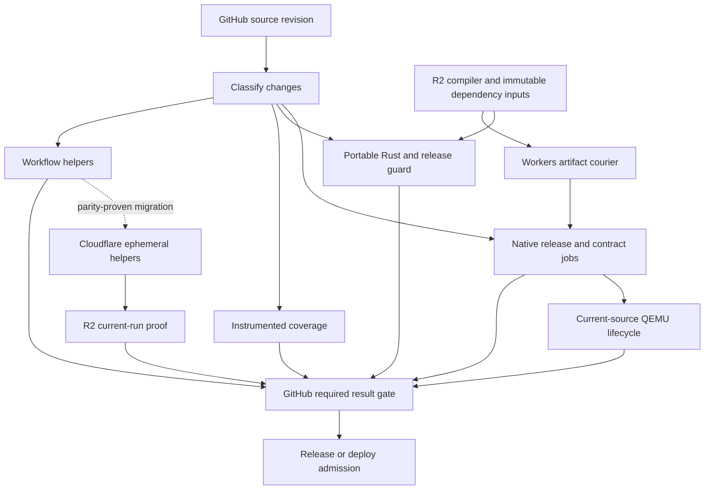

# GitHub and Cloudflare CI research and implementation plan

Reviewed November 10, 2026, America/Chicago. Current main baseline is `6e37c4b1b558d7a4637ba0bf0496db508d13c6e3`, which merged PR #1054. Its tree is identical to reviewed head `5511b21eb6770ed89984d4c6550dd9d0bf55d951`. The reviewed Cloudflare CI SDK is `@cloudflare/ci` 0.2.0 at `fbbc2902c07c8ac89612f915f28c58c9b0941dbd`. This document governs the next CI changes. Earlier October agent-automation documents describe historical deployments.

## Objective and completion conditions

Reduce elapsed time from a GitHub commit or PR update to all required successful checks to six or seven minutes. Record cold and warm results separately. The target includes queue time, coverage and native acceptance. A fast benchmark job alone cannot establish the target.

Record completion times for merge readiness, exact-main release eligibility and published delivery. Merge-ready requires both protected check contexts and their complete selected job graphs. Release eligibility also retains the seven exact-commit push workflows below. Published delivery includes packaging, staged smoke tests, provenance, GitHub publication and R2 round-trip verification. Report all three. A faster merge gate does not establish faster publication. Scheduled mutation, fuzzing and release QA retain their own complete execution budgets and results.

Use the existing checkout on C:, GitHub's available standard runners and Cloudflare Startup credits. Keep the coding agent local. Review tests encountered during this work. QEMU retirement requires equivalent replacement execution for each affected contract.

The earlier research missed the official Cloudflare CI SDK. This review covers its documentation, pinned implementation, dependencies, examples and compatibility with OMG. Every proposed implementation below has an entry check and an acceptance check.

## Current execution and measured delays

The checked-in pipeline builds on GitHub. `services/ci` is an optional plain Ubuntu Cloudflare runtime pilot. The retired issue-repair agents have separate historical configuration. The pilot uses a source-specific image, which adds build and rollout time to each attempt. [Current CI source](https://github.com/omg-cli/omg/blob/6e37c4b1b558d7a4637ba0bf0496db508d13c6e3/.github/workflows/ci.yml), [pilot workflow](https://github.com/omg-cli/omg/blob/6e37c4b1b558d7a4637ba0bf0496db508d13c6e3/.github/workflows/cloudflare-native-ci.yml), [pilot evidence](../benchmarks/cloudflare-runtime-pilot-2026-11-10.json)

| Measurement | Observed result | Interpretation |
| --- | --- | --- |
| Main `6e37c4b1`, CI `42957876886` | CI Success completed 24m08s after run creation. Whole workflow 24m17s. | Successful first attempt with all selected native and guest gates. Six-to-seven minutes remains unproven. |
| Same main, coverage `42957876615` | Successful required report at 7m43s after run creation. Producer 7m10s. Report job 18s. | Exact-base and producer-attempt admission passed. Coverage still exceeds the target. |
| Same main, Benchmark `42957876635`, attempt 1 | Workflow success at 11m50s. Benchmark job 11m47s. Release build 10m37s. Helper job 9m55s. | The first trusted-main run passed. The successful same-source warm rerun took 9m11s. Both old-source diagnostic ZIPs omit context. Empty-prefix cold behavior and the fixed hosted upload remain unproven. |
| Same main, Docker `42957876599` and CodeQL `42957876677` | Docker workflow 7m44s, including a 6m43s image build. CodeQL workflow 11m12s, including 10m43s Rust analysis. | Independent release-prerequisite costs need their own measurements and changes. |
| Main CI at `574e7d6c`, run `42939262587` | Required CI Success at 35m21s after workflow creation. Entire workflow 35m32s. | Successful complete baseline. |
| Exact same main coverage, run `42939262354` | 10m56s elapsed, successful. | Coverage runs alongside CI. |
| Matched isolated R2 diagnostic, run `42925029452`, attempts 1 and 2 | 31m40s cold, 18m37s warm. Portable Rust 30m38s to 11m26s. | Same source and cache prefix. This diagnostic excludes QEMU. |
| Same R2 diagnostic counters | Warm 6,782 hits out of 6,798 cacheable compilations. Zero cache read or write errors in both attempts. | Real cache benefit with a remaining execution and linking cost. |
| Fedora full RPM comparison, successful run `42939989971` | Two CPUs 18m23s. Four CPUs 12m35s. Both complete bundles admitted. | One matched pair. Earlier pair improved by only 83s, so variability matters. |
| Ubuntu QEMU lifecycle at successful main `574e7d6c` | Lifecycle step 715s. | This single required step already exceeds seven minutes. |
| Workflow checks at `67678bad`, run `42944756099` | `make ci-workflow-quick` 530s. Its 1,515 script tests consumed 461.479s. Release-smoke fixture approximately 51.4s. | Profile and divide independent helper suites before changing their selection. |
| Portable release guard in PR run `42944845165` | 499s. | A release-mode Rust test build is another complete-gate constraint. |
| Cloudflare Ubuntu pilot at `b58aba89` | Full job 19m16s. Hosted runtime step 32s. | The two selected tests and catalogue recipe passed. Full pipeline speed remains unproven. |
| Cloudflare release compilation trial | Both binaries failed to finish within 1,200s on standard-4. | Provider migration alone has no demonstrated compiler speed advantage. |

Sources are the [successful complete CI](https://github.com/omg-cli/omg/actions/runs/42939262587), [paired coverage](https://github.com/omg-cli/omg/actions/runs/42939262354), [R2 pair](https://github.com/omg-cli/omg/actions/runs/42925029452), [successful CPU comparison](https://github.com/omg-cli/omg/actions/runs/42939989971), [current main CI](https://github.com/omg-cli/omg/actions/runs/42944756099), [PR CI](https://github.com/omg-cli/omg/actions/runs/42944845165), and [Cloudflare compilation receipt](../benchmarks/cloudflare-release-build-limit-2026-11-10.json). Samples from different sources or hosts are separate observations.

The new baseline receipts are [main CI](https://github.com/omg-cli/omg/actions/runs/42957876886), [required CI check](https://github.com/omg-cli/omg/runs/130325665472), [main coverage](https://github.com/omg-cli/omg/actions/runs/42957876615), [Benchmark attempt 1](https://github.com/omg-cli/omg/actions/runs/42957876635/attempts/1), [Docker](https://github.com/omg-cli/omg/actions/runs/42957876599) and [CodeQL](https://github.com/omg-cli/omg/actions/runs/42957876677). CI was created at `2026-11-11T04:14:04Z`. Its required check completed at `04:38:12Z`, and its final tag job completed at `04:38:21Z`.

Local full-helper profiling failed setup or timed out with Linux toolchain, venv, HOME and DrvFS/Git-metadata problems. Those runs provide no accepted timing baseline or shard weights. Separate Linux discovery at head `5511b21e` found 1,539 distinct test IDs in 109 modules. Discovery does not establish execution. Historical counts and hosted timings above belong to their stated revisions.

Main coverage at `67678bad` initially failed because LLVM exported a saturated derived counter at `src/hooks/mod.rs:468`. The error arm had count zero while its return region had count one. The comparison rejected the result. The first failure's reports and logs were preserved before rerunning the instrumented producer. The second attempt's tests passed, then artifact admission failed because the run contained two `coverage-lcov` artifacts. This exposes a separate rerun-identity gap. Raw profile diagnostics are still required to establish the counter failure's cause. [First attempt](https://github.com/omg-cli/omg/actions/runs/42944755869/attempts/1), [second attempt](https://github.com/omg-cli/omg/actions/runs/42944755869/attempts/2)

That baseline was recovered through report-only attempt 3 after preserving the original failed comparison and proving two retired standalone copies were byte-identical to it. PR #1054 subsequently merged producer-owned immutable-ID downloads, digest/size verification, qualified upload names, local region validation and bounded failure diagnostics. Head `5511b21e` passed CI and coverage. Its report-only rerun passed, and the new main baseline above also passed. The original LLVM counter defect remains unresolved. [Recovered baseline](https://github.com/omg-cli/omg/actions/runs/42944755869/attempts/3), [head CI](https://github.com/omg-cli/omg/actions/runs/42953024306/attempts/2), [head coverage report rerun](https://github.com/omg-cli/omg/actions/runs/42953024082/attempts/2)

### Same-source Benchmark R2 observation

Both attempts of main `6e37c4b1` succeeded with the same `benchmark-v1/` R2 prefix and sccache 0.18.0. The first namespace use was observed, but its emptiness was not independently established. Each statistics ZIP passed immutable artifact-ID, size and SHA256 verification before analysis. [Attempt 1](https://github.com/omg-cli/omg/actions/runs/42957876635/attempts/1), [attempt 2](https://github.com/omg-cli/omg/actions/runs/42957876635/attempts/2), [compact receipt](../benchmarks/github-benchmark-r2-2026-11-11.json)

| Measurement | First observed use | Warm rerun |
| --- | --- | --- |
| Complete Benchmark workflow | 11m50s | 9m11s |
| Benchmark measurement job | 11m47s | 7m59s |
| Release build step | 10m37s | 6m41s |
| Duplicate helper job | 9m55s | 9m07s |
| Compiler cache hits / misses | 76 / 2,047 | 2,118 / 5 |
| Cache read errors / write errors / timeouts | 0 / 0 / 0 | 0 / 0 / 0 |

The helper job controls the warm workflow's completion time. This single pair supports the compiler-cache transport improvement. It excludes the other required CI and coverage workflows. Both container diagnostic ZIPs lack the context sidecar under the old recipe. The repair below needs a new hosted run with both files retained. Attempt-specific API creation and update times establish workflow duration because the latest-run endpoint retains the original creation time across reruns.

### Stage 2 diagnostic artifact repair

The first Benchmark cache ZIP contains the statistics file but omits its context file. Runner 2.338.2 passes the entire multiline action input through container-path translation once. Only a leading host prefix is replaced. Subsequent absolute host paths can remain unreadable in the container. `if-no-files-found: error` rejects zero matches, so one surviving file can hide this loss. The source chain is [input construction](https://github.com/actions/runner/blob/d1eb12d4b115c301201de27d667284e1a80f2ab5/src/Runner.Worker/Handlers/Handler.cs#L175-L187), [whole-value translation](https://github.com/actions/runner/blob/d1eb12d4b115c301201de27d667284e1a80f2ab5/src/Runner.Worker/Handlers/StepHost.cs#L326-L331), and [leading-prefix replacement](https://github.com/actions/runner/blob/d1eb12d4b115c301201de27d667284e1a80f2ab5/src/Runner.Worker/Container/ContainerInfo.cs#L164-L195).

| Caller surface | Evidence and bounded repair |
| --- | --- |
| Benchmark compiler diagnostics | Runtime-confirmed omission. Write `omg-r2-cache-stats.json` and `omg-r2-cache-context.txt` under owned `$RUNNER_TEMP/omg-r2-cache/`, then upload one scalar directory path. |
| CI portable compiler diagnostics | Host-only caller has the same multiline shape. Use the same owned directory and scalar input for consistent behavior. Missing hosted evidence is not established. |
| CI portable-release compiler diagnostics | Apply the same narrowly scoped path change. Preserve existing enable conditions, names, retention and owned-daemon EXIT cleanup. |
| QEMU lane staged-build timings | Container caller mixes a relative timing path and an absolute runner-temp path. Source predicts translation loss. Set the helper output to `target/staged-unit-tests` and upload both intended subdirectories by relative paths under `target`. |
| QEMU matrix ARM staged-build timings | Apply the same relative-path recipe and prove its layout. Current main skipped staged builders because it reused native artifacts, so it supplies no runtime ZIP-loss proof. |

The focused R2 regression executes each reporting shell with a controlled sccache stub and requires both produced files to survive the actual scalar upload contract. It failed for all three original R2 inputs. The bounded directory fix now passes focused Linux/Windows checks and actionlint. Hosted complete-pair admission is still required. Test the two QEMU callers separately, preserving `cargo-timings` and `staged-unit-tests` layout without a copy step, whole-target upload or artifact-consumer change. Preserve the valid empty receipt directory for non-Fedora staged builds. Preserve the original first Benchmark result. Transport-diagnostic repair does not turn it into an empty-namespace cold sample.

## Complete workflow and gate inventory

The default tree has 23 workflow files: 19 active and four manually disabled. The live registry has 29 entries. The table records actual event eligibility. Reusable workflows expand within callers and do not create independent push runs. Cron expressions below are UTC. The exact source for this inventory is [main's workflow directory](https://github.com/omg-cli/omg/tree/6e37c4b1b558d7a4637ba0bf0496db508d13c6e3/.github/workflows).

| Workflow | Events and current state | Contract, reusable inputs and next treatment |
| --- | --- | --- |
| `ci.yml` | Active on main push, PR, merge group, manual. | Required `CI Success` includes helpers, portable/debug and release guards, six native Linux environments, five platform Clippy jobs, SQLite supply, macOS, source-built nextest, sandbox, accounting and both QEMU partitions. Cache compatible dependencies. Preserve every selected execution and strict final gate. |
| `coverage.yml` | Active on main push, PR, merge group, manual. | Required instrumented producer and exact-base report. Reuse instrumented dependency objects under the same LLVM/toolchain/flags. Ordinary release binaries and previous test results cannot substitute. |
| `benchmark.yml` | Active on main push, manual. Sunday `17 1 * * 0`. | Release prerequisite. Actual performance threshold plus host helper job. Manual matched Rust comparison is a separate route. Reuse compatible compiler inputs, preserve measured-binary recipe and elevated helper probes. |
| `audit.yml` | Active on main push, dependency-path PR, manual. Daily `13 0 * * *`. | Release prerequisite: cargo-audit and cargo-deny cover different properties. Cache immutable tools/package inputs. Refresh advisory data and execute both checks. |
| `secrets.yml` | Active on main push, all PRs, manual. | Release prerequisite: Gitleaks and TruffleHog remain distinct. Reuse immutable tool/history downloads, not an earlier green scan. |
| `codeql.yml` | Active on main push, source/workflow-path PR, manual. Monday `0 0 * * 1`. | Release prerequisite: Rust and Actions analysis, both `build-mode: none`. Profile actual analysis. Preserve queries, categories and SARIF publication. |
| `docker-e2e.yml` | Active on main push, Docker/source-path PR, manual. Daily `0 2 * * *`. | Release prerequisite: current-source Arch image and actual Docker tests. Existing GHCR layer cache is separate from Cargo cache. Stage 6b below keeps daily native refresh and the public fork read route. |
| `release.yml` | Active on `v*` tag push and manual. | Exact-main gates, six native builders, every staged ABI/Linux/macOS smoke, SBOM, attestation, publication and R2 verification. Candidate binary reuse needs complete original producer and release-packaging provenance. |
| `changelog.yml` | Active on main push except changelog-only changes, published release, manual. | Generates a review artifact. No application compilation or automatic source publication. Small metadata/tool cache only. |
| `fedora-sqlite.yml` | Active, reusable call only. | Full checked source/binary RPM suite for x86 or ARM callers. Stage 4 admits a strongly bound historical dependency build while current application tests still execute. |
| `qemu-matrix.yml` | Active on reusable call, manual. Daily `17 3 * * *`. | Both required CI partitions and distinct manual/nightly release/ARM routes. Keep exact guest union, preflight, failure classification and coordinator gate. |
| `qemu-lane.yml` | Active, reusable call only. | Same-source native-artifact reuse in CI. Standalone staged calls still build as selected. Preserve per-distro ABI/owner checks, disposable guest behavior and 60-second admission after readiness. |
| `qemu-report.yml` | Active on completed main CI/QEMU workflow events. | Trusted bounded evidence classification and issue reporting. Keep write credentials out of untrusted guest execution. No code from downloaded artifacts. |
| `qemu-maintenance.yml` | Active on manual. Daily `23 8 * * *`. | Pin-review issue maintenance with narrow controller permissions. No native application compilation. |
| `qemu-vsock-capability.yml` | Active on probe-path PR and manual. | Optional x64/ARM capability observation. Preserve negative evidence. Observation alone cannot establish KVM/vsock parity. |
| `release-smoke.yml` | Active on smoke-path PR, manual. Daily `23 4 * * *`. | Four Linux distributions and native macOS published-release QA. Optional Ubuntu upgrade. Reuse immutable downloads, then execute installs/upgrades and smoke contracts. |
| `fuzz.yml` | Active on manual. Monday `0 3 * * 1`. | Distinct bounded fuzz campaign. Reuse matching dependencies and corpus inputs. Preserve sanitizer build, execution budget and crashes. |
| `mutation.yml` | Active on selected-test/source PR, manual. Sunday `43 3 * * 0`. | PR baseline or 16 mutation shards, at most four concurrent. Preserve baseline and every mutant outcome. Dependency cache is not a cached mutation result. |
| `cloudflare-native-ci.yml` | Active on selected paths on `ci/plain-cloudflare`, manual main. | Optional production-environment pilot, not an automatic main-push competitor. Includes immutable image build, offline proof, rollout, courier and teardown. |
| `ci-orchestration.yml` | Manually disabled. Source contains main/PR/merge-group triggers. | Historical contracts/types/dry builds. Do not count it as active slot use or silently restore retired infrastructure. |
| `cloud-ci.yml` | Manually disabled. Manual and Security Audit completion routes in source. | Historical Cloudflare/dependency-repair controller. Keep disabled. |
| `ai-review.yml` | Manually disabled. Scheduled/manual source review in source. | Retired model/continuation system. No role in the selected ordinary CI design. |
| `ai-fix-review.yml` | Manually disabled. Manual/completion events in source. | Retired independent AI review. Keep disabled. |

The six registry-only entries are platform-managed Dependabot Updates, Dependency Graph and dynamic CodeQL, plus three historical one-off YAML entries absent from this default tree: optional controller-image measurement, Wave10 test-quality proof and local cache rehearsal. Registry `active` does not prove an executing main trigger. Default CodeQL setup is currently `not-configured`. No duplicate default/custom CodeQL execution is established. The two custom analyses do not compile the application through Cargo. [CodeQL source](https://github.com/omg-cli/omg/blob/6e37c4b1b558d7a4637ba0bf0496db508d13c6e3/.github/workflows/codeql.yml), [default-setup API](https://docs.github.com/en/rest/code-scanning/code-scanning#get-a-code-scanning-default-setup-configuration), [official build modes](https://docs.github.com/en/code-security/how-tos/find-and-fix-code-vulnerabilities/manage-your-configuration/codeql-for-compiled-languages)

The live main ruleset requires exactly `CI Success` and `Generate Coverage Report`, from GitHub Actions App `15368`, with strict up-to-date checks and no bypass actors. Classic branch-protection API returning 404 does not remove this ruleset protection. Tag rules separately prevent updates and deletion of `v*`. Keep check names, App identity, classification and complete transitive job requirements. [Main rules](https://github.com/omg-cli/omg/rules/23399194), [tag rules](https://github.com/omg-cli/omg/rules/23399197)

For a new version, CI's tag job additionally requires successful exact-commit push runs from Benchmark, Security Audit, Secret Scanning, custom CodeQL Analysis, Code Coverage and Docker E2E. The Release workflow checks CI plus those six again. `require-workflow-success.sh` rechecks that no newer failed push run replaced the watched success. Keep these prerequisites even though they are not separate merge-rule contexts. Existing tags cause an early no-publication exit. [Tag gate](https://github.com/omg-cli/omg/blob/6e37c4b1b558d7a4637ba0bf0496db508d13c6e3/.github/workflows/ci.yml#L2034), [release gate](https://github.com/omg-cli/omg/blob/6e37c4b1b558d7a4637ba0bf0496db508d13c6e3/.github/workflows/release.yml#L38), [exact-run watcher](https://github.com/omg-cli/omg/blob/6e37c4b1b558d7a4637ba0bf0496db508d13c6e3/scripts/require-workflow-success.sh)

### Concrete duplication and release reuse

Required CI's `make ci-workflow-quick` and Benchmark's helper job both run broad `scripts/test_*.py` discovery. Benchmark additionally executes two sudo probes for QEMU health and evidence export. A future shared same-source helper receipt must bind actual test identities, UID/tool/environment recipe and successful owner. Preserve those elevated probes and full manual/scheduled fallback. Admit the helper job's evidence without waiting for the whole CI workflow: the CI tag job can itself wait for Benchmark. [CI helper selection](https://github.com/omg-cli/omg/blob/6e37c4b1b558d7a4637ba0bf0496db508d13c6e3/Makefile#L287), [Benchmark helpers](https://github.com/omg-cli/omg/blob/6e37c4b1b558d7a4637ba0bf0496db508d13c6e3/.github/workflows/benchmark.yml#L98)

Release currently rebuilds six native application pairs after CI. Reusing exact successful CI pairs could remove that repeated compilation, but requires matching source, producer run/attempt, image, compiler, CPU/ABI/features, build recipe and relevant native package inventory. Preserve source-derived version/README/LICENSE packaging, every staged smoke, SBOM, checksums, signer workflow/ref, publication and R2 round-trip verification. Carry original CI binary/build receipts into the release evidence chain. Release attestation authenticates its packaging without relabelling binaries as newly compiled by Release. [Release builders and consumers](https://github.com/omg-cli/omg/blob/6e37c4b1b558d7a4637ba0bf0496db508d13c6e3/.github/workflows/release.yml)

Benchmark Arch is not interchangeable with CI/release Arch: feature defaults agree, but CI/release set `x86-64-v2` and Benchmark does not. Docker uses another pinned Arch base and image recipe. Coverage instruments another build. Preserve those contracts and share only compatible inputs. The benchmark script's previous second build is already removed. Do not count that saving again.

## Cloudflare has several distinct CI integration paths

| Path | Actual capability | Fit for OMG |
| --- | --- | --- |
| GitHub Actions deploying through Wrangler | GitHub runs commands and supplies a scoped deployment token. | Existing deployment path and simplest authority for merge and release. |
| Workers Builds connected to GitHub | Managed build and Worker deployment on push. Current limit is 20 minutes, four CPUs and 8 GB on Paid, with six concurrent builds. | Suitable for Worker control-plane deployment. Validate Rust commands and caching before assigning native build work. |
| Cloudflare CI SDK | A Worker Workflow runs parallel sandbox commands and caches dependency snapshots. Artifacts push events can trigger it directly. | Useful orchestration. Version compatibility and OMG's source, test, cleanup and provenance contracts require explicit adaptation. |
| Ephemeral GitHub runner in a Cloudflare Container | The normal GitHub job executes in a per-job Cloudflare VM through a runner integration. | Potentially preserves YAML, job IDs and GitHub reporting while adding compute outside hosted-runner slots. Requires runner and Docker compatibility proof. |
| GitHub with Cloudflare cache and artifact services | GitHub executes native jobs while R2, Workers and the registry distribute reusable inputs. | Chosen immediate integration. It addresses measured repeated work with the smallest change to acceptance. |

The documented [Wrangler integration](https://developers.cloudflare.com/workers/ci-cd/external-cicd/github-actions/), [Workers Builds limits](https://developers.cloudflare.com/workers/ci-cd/builds/limits-and-pricing/), [official CI guide](https://developers.cloudflare.com/artifacts/guides/build-and-deploy-on-push/), and [Cloudflare CI announcement](https://blog.cloudflare.com/ci-workflows/) describe different execution paths. The Artifacts-first CI SDK runs atop Workflows and Sandbox.

## Official CI SDK compatibility

Cloudflare CI 0.2.0 is a real published package. Its core uses Workflows and Sandbox. The optional self-healing example owns the AI integrations. The plain core can run ordinary commands without an AI model. The package exports TypeScript for Workers-aware bundlers and requires `nodejs_compat` for its Worker entrypoint. [Pinned package](https://github.com/cloudflare/ci/blob/fbbc2902c07c8ac89612f915f28c58c9b0941dbd/package.json), [pinned README](https://github.com/cloudflare/ci/blob/fbbc2902c07c8ac89612f915f28c58c9b0941dbd/README.md)

| Verified implementation detail | Required adaptation before adoption |
| --- | --- |
| Version 0.2.0 pins Sandbox 0.12.1. | Pin an actual compatible SDK and image pair. Test its Wrangler configuration against the current scheduling generation. |
| Its example package can still resolve CI 0.1.0. | Verify the installed lockfile version and deployed bundle identity. |
| The shipped source adapter is Artifacts-first. | Specify GitHub-to-Workflow dispatch and result admission, or an authenticated exact-source mirror. |
| Snapshot cache covers `/workspace`. | Put reusable Cargo inputs in an explicit cached directory. Preserve installed OS dependencies through a compatible base image, verified RPM bundle, or full-filesystem snapshot. |
| Checkout overlays the restored source and leaves deleted files. | A source-deletion and rename fault must pass. Reconcile the checkout against the exact source tree while preserving only declared dependency output. |
| A cache hit skips the cached command. | Cache installation and compilation inputs. Run current application tests. Record explicitly admitted historical dependency checks under their original build identity. |
| The key includes repository, command, environment and selected input blobs. | Include image digest, architecture, compiler, feature set, build profile and relevant dependency closure in declared inputs. |
| Source checkout excludes `.git`. | Supply verified source identity and adapt commands that currently obtain it from Git. |
| Default retry settings can rerun a failed command. | Set test retries explicitly to preserve the original first-failure result. Separate bounded transport retries from test results. |
| Raw command logs can contain secrets. | Keep cloud and GitHub write credentials in the trusted controller. Store bounded, access-controlled logs and redact displayed diagnostics. |
| Cleanup and failure output differ from OMG's current controller. | Execute failure, timeout and cancellation controls. Require complete evidence and provider-confirmed destruction. |

These findings come from the pinned [sandbox runner](https://github.com/cloudflare/ci/blob/fbbc2902c07c8ac89612f915f28c58c9b0941dbd/src/ci/runners/sandbox.ts), [cache implementation](https://github.com/cloudflare/ci/blob/fbbc2902c07c8ac89612f915f28c58c9b0941dbd/src/ci/cache.ts), and [pipeline types](https://github.com/cloudflare/ci/blob/fbbc2902c07c8ac89612f915f28c58c9b0941dbd/src/pipeline/types.ts). Adoption requires passing those controls with the chosen version.

Current native Container snapshots save the writable root filesystem, including installed RPM state. Separately mounted filesystems, memory and running processes are excluded. Snapshots use the `durable_object` scheduling policy and remain tied to the original image. Their 30-day retention refreshes on restore. The application must enforce its own build-age policy. This native API is separate from CI SDK 0.2.0's directory backups. [Native snapshots](https://developers.cloudflare.com/containers/guides/snapshots/), [Sandbox directory backups](https://developers.cloudflare.com/sandbox/reference/directory-backups/)

The `default` scheduling policy was deprecated November 4. Migration creates a replacement application and namespace. Under `durable_object`, a nonzero execution UID still receives root capabilities. Verify protected-file denial, irreversible privilege reduction and descendant behavior in the replacement. Run a new teardown canary. [Scheduling policies](https://developers.cloudflare.com/containers/configuration/scheduling-policy/), [migration procedure](https://developers.cloudflare.com/containers/guides/migrate-to-durable-object-scheduling-policy/), [native execution capabilities](https://developers.cloudflare.com/containers/api/durable-object-container/#exec)

## Ephemeral GitHub runners on Cloudflare

SuperCI is an MIT-licensed implementation with a Cloudflare control plane and ephemeral Cloudflare GitHub runners. AWS is optional. Reviewed version 0.20.3 is `f109f80ffcced2625d5239034c07096a06cbf830`. It is the first runner-integration candidate for the trusted helper pilot because it preserves GitHub's normal execution and reporting model. [Project source](https://github.com/supercorp-ai/superci/tree/f109f80ffcced2625d5239034c07096a06cbf830), [Cloudflare provider](https://superci.dev/docs/providers)

| Source-verified behavior | OMG pilot condition |
| --- | --- |
| The organization App requests runner management, Actions write and metadata read. | Use a dedicated installation limited to OMG. Keep the App key in the control plane. |
| One JIT runner handles one matching queued job. | Verify the actual GitHub job identity through existing source, run, attempt and artifact admission. |
| Public repositories require an allowlist. Fork PRs and `pull_request_target` are refused. | Route forks to standard GitHub-hosted execution before dispatch. Run a real refusal canary. |
| Refusal handling appears to mark internal failure without invoking the normal failure runner. | Verify that GitHub receives a terminal failed result. This is a source prediction awaiting execution. |
| Cloudflare capacity is Linux x64, four CPUs, 12 GiB and 20 GB. | Start with two bounded independent helper shards. Measure resource use and cold tool setup. |
| Named custom runner images are currently Modal-only. | Validate the supplied runner and ordinary pinned `job.container` images. A custom Cloudflare runner image requires an implementation change. |
| Its Docker wrapper converts runner networks to host networking. | Execute service, socket, ordinary-user, namespace and cancellation controls for each selected job. |
| Completion handling and an independent timeout alarm stop instances. | Confirm destruction after success, failure, cancellation, duplicate webhook and controller restart. |

The reviewed [App manifest](https://github.com/supercorp-ai/superci/blob/f109f80ffcced2625d5239034c07096a06cbf830/crates/core/src/github.rs), [runner environment](https://github.com/supercorp-ai/superci/blob/f109f80ffcced2625d5239034c07096a06cbf830/crates/runners-cloudflare/src/job_runner.rs), [Docker wrapper](https://github.com/supercorp-ai/superci/blob/f109f80ffcced2625d5239034c07096a06cbf830/crates/core/src/docker.rs), and [policy controller](https://github.com/supercorp-ai/superci/blob/f109f80ffcced2625d5239034c07096a06cbf830/crates/core/src/plane.rs) establish these implementation details. They establish eligibility for a pilot, with hosted acceptance still pending.

## Service selection and credit budget

The active dashboard readback during this work showed a $10,000 award balance and an October 6, 2027 expiry. The public policy covers most compute, storage and Developer Platform usage. It explicitly lists Workers, Durable Objects, Workflows, R2, Queues, KV and D1. The R2 ceiling shares the award balance. Containers and Artifacts have documented usage charges and broad policy support. Their account-specific invoice deductions have yet to be observed. [Startup terms](https://www.cloudflare.com/startups/), [Containers pricing](https://developers.cloudflare.com/containers/platform/pricing/), [Artifacts pricing](https://developers.cloudflare.com/artifacts/platform/pricing/)

| Service | CI role and decision |
| --- | --- |
| R2 | Compiler objects, immutable dependency bundles, closed evidence archives and snapshot backing. Apply lifecycle rules by data class. |
| Workers | Narrow artifact courier, optional short-lived read credential broker and authenticated dispatch. Stream large objects. |
| Workflows | Durable Cloudflare job lifecycle, bounded transport retries, status and cleanup. Keep large logs in R2 and return compact receipts. |
| Durable Objects | Per-run ownership and lifecycle. Reuse the chosen runner's controller where possible. |
| Containers and managed OCI registry | Reusable digest-pinned toolchain and distro images, then disposable Linux execution after parity tests. |
| Artifacts | Exact-source mirror and direct SDK event integration if that path earns adoption. Current GitHub checkout takes seconds, so measure the additional mirror and trigger costs. |
| Workers Cache and CDN | Serve immutable, content-addressed courier objects after verifying cache isolation and size limits. Keep mutable selection and authorization responses fresh. |
| Queues | Add only if dispatch buffering or completion events need durable decoupling beyond the selected Workflow. |
| D1 or Analytics Engine | Optional historical timing and reliability queries once compact run receipts identify a reporting need. |
| KV | Optional disposable lookup data. Artifact admission requires strong source and digest evidence independent of a cached lookup. |
| Cache Reserve and Argo | Evaluate only against a measured transfer bottleneck and supported request path. |

Workers Builds' automatic package cache documents JavaScript package-manager directories and a 10 GB project limit. Cargo caching requires an explicit proven path. Workers Cache accelerates HTTP responses and bills standard Worker requests. R2-backed sccache remains the compiler-cache mechanism. [Build caching](https://developers.cloudflare.com/workers/ci-cd/builds/build-caching/), [Workers Cache](https://developers.cloudflare.com/workers/cache/), [sccache R2 configuration](https://github.com/mozilla/sccache/blob/v0.18.0/docs/S3.md)

Artifacts is Git-backed source storage. Its current limits include 32 MiB per file, 64 MiB per push and 1 GB for a new repository. Store larger compiler and runtime archives in R2 or the OCI registry. The current pricing page says Artifacts usage billing starts November 12, 2026. This supersedes the billing-date assumption in the October review. [Artifacts limits](https://developers.cloudflare.com/artifacts/platform/limits/), [current pricing](https://developers.cloudflare.com/artifacts/platform/pricing/)

Use existing subscribed services within the observed award. Start new compute trials with at most two concurrent instances, a 15-minute lifetime and one diagnostic wave. Record resource-seconds, storage growth, remaining award and expiry. At current published resource rates, one standard-4 instance fully using four CPUs for ten minutes is approximately $0.06684 before included allowances, network and controller charges. Usage ceilings bound consumption. Provider invoice application remains a separate observation. [Resource rates](https://developers.cloudflare.com/containers/platform/pricing/)

The selected pipeline contains ordinary build and test execution. Workers AI and AI Gateway have no role. The user requires all CI expansion to stay within the Startup award.

## GitHub credentials and trust boundaries

Existing repository cache secrets are `OMG_R2_CACHE_ACCESS_KEY_ID` and `OMG_R2_CACHE_SECRET_ACCESS_KEY`. Repository variables provide the account ID and opt-in. The production environment already has `CLOUDFLARE_ACCOUNT_ID` and `CLOUDFLARE_API_TOKEN`. The plain pilot has `OMG_NATIVE_CI_TOKEN`. Verify names and scopes through metadata and actual probes. Keep secret values out of logs and receipts. [Cloudflare deployment setup](https://developers.cloudflare.com/workers/ci-cd/external-cicd/github-actions/), [R2 token scope](https://developers.cloudflare.com/r2/api/tokens/)

Trusted main publication can use bucket-scoped writes. Public fork consumers can read curated, verified dependency bundles through a GET/HEAD-only Worker. Limit that Worker to the dependency namespace. Private compiler objects and evidence stay private.

Same-repository PR compiler caching has an explicit stage 2b below. External-fork OIDC availability needs a real canary. The initial broker excludes fork heads even if a token is available. Keep the existing hosted cold path wherever access is ineligible or unavailable. [GitHub OIDC claims](https://docs.github.com/en/actions/reference/security/oidc), [R2 temporary credentials](https://developers.cloudflare.com/r2/api/s3/temporary-credentials/)

Every artifact receipt binds source SHA, producer run and attempt, consumer run and attempt, architecture, OS image, ABI recipe and file digests. A reused dependency keeps its original build identity. Current application tests record their own identity. Verify GitHub provenance against the expected repository and workflow before admission. [GitHub artifact attestations](https://docs.github.com/en/actions/how-tos/secure-your-work/use-artifact-attestations/use-artifact-attestations), [attestation verification](https://cli.github.com/manual/gh_attestation_verify)

R2 publication writes immutable archive and proof objects first. Publish the selection pointer last with conditional writes. Reject missing, stale or mismatched objects. Keep real source-build completion time distinct from upload or signature time. R2 provides strong consistency and conditional operations. [Consistency](https://developers.cloudflare.com/r2/reference/consistency/), [conditional writes](https://developers.cloudflare.com/r2/api/s3/conditional-operations/)

### Stage 2b: same-repository PR compiler-cache reads

After trusted-main write/replay and matched cache proof pass, add one small Workers OIDC broker for the existing `omg-ci-compiler-cache` bucket and `portable-v1/` prefix. Portable and portable-release PR jobs receive 45-minute, server-enforced GET/HEAD-only authority. This uses existing Workers/R2 coverage. No new bucket, parent key, Containers, Artifacts or AI service is presumed.

Grant `contents: read` and `id-token: write` at the portable and portable-release job level. These current jobs lack the OIDC grant. Preserve every other job's required permissions and keep this grant out of workflow-global defaults. [GitHub OIDC permissions](https://docs.github.com/en/actions/reference/security/oidc#required-permission)

Deploy the broker only from trusted-main controller code. Check that the existing production Cloudflare token can update this Worker. Pass the existing R2 key pair to Worker secrets through pinned Wrangler's stdin JSON interface. Never command arguments, logs or artifacts. An authorization failure is an entry finding, not permission to create another credential automatically. [Wrangler secret bulk](https://developers.cloudflare.com/workers/wrangler/commands/workers/#secret-bulk)

The broker verifies RS256 against the fixed GitHub issuer/JWKS, custom audience, time claims, immutable repository ID `1133413326`, owner ID `329545359`, workflow identity, `pull_request` event, PR merge ref, source, run and attempt. A YAML job name is not signed identity. If a pinned reusable workflow is selected later, verify its documented `job_workflow_ref` and `job_workflow_sha`. Bound request/JWKS processing and issuance per verified run/attempt. [Issuer discovery](https://token.actions.githubusercontent.com/.well-known/openid-configuration), [OIDC claims](https://docs.github.com/en/actions/reference/security/oidc)

JWT repository identity alone does not establish the PR head repository. Parse only `refs/pull/N/merge`, query that PR in the fixed OMG repository, and require both head/base repository IDs to match, base main, and the current merge SHA to equal the JWT SHA. Reject missing, deleted or stale metadata. Cache admission only under exact PR/run/attempt/source identity for a bounded lifetime. Public unauthenticated metadata has a 60-request/hour/IP limit. Measure shared-egress availability. If that prevents adoption, choose a deliberate authenticated metadata design rather than removing the head-repository check. [PR metadata](https://docs.github.com/en/rest/pulls/pulls#get-a-pull-request), [REST rate limits](https://docs.github.com/en/rest/using-the-rest-api/rate-limits-for-the-rest-api)

Mint with R2 local signing, which supports exact actions. The Temporary Credentials API does not yet support action scoping. Fix bucket, `actions: ["GetObject", "HeadObject"]`, `paths.prefixPaths: ["portable-v1/"]` and 2,700-second expiry. Supply actions instead of a broader scope, without listing, writes, multipart or Benchmark-prefix access. The parent remains inside the Worker. Deliver the temporary triple with no-store and masking, not GITHUB_ENV, outputs or artifacts. PR-controlled code may read that limited authority. Security relies on server-enforced actions/prefix/expiry, not confidentiality inside PR execution. [R2 temporary credential contract](https://developers.cloudflare.com/r2/api/s3/temporary-credentials/)

The exact sccache 0.18.0 source supports `SCCACHE_S3_RW_MODE=READ_ONLY`. Its locked signing dependency loads `AWS_SESSION_TOKEN`. Prove actual R2 session-token requests with the deployed binary before promotion. Start an owned unique daemon immediately before compilation, with credentials only in its server environment. Strip all three AWS values from compiler clients and preserve failure/cancellation cleanup. The jobs have 40-minute bounds, covered by a fresh 45-minute credential. Do not assume daemon credential renewal. [Pinned S3 configuration](https://github.com/mozilla/sccache/blob/01c35e69b97f516c2ebfbdb418b5cd6277bde280/docs/S3.md), [locked dependencies](https://github.com/mozilla/sccache/blob/01c35e69b97f516c2ebfbdb418b5cd6277bde280/Cargo.lock), [session-token provider](https://docs.rs/reqsign-aws-core/3.1.0/src/reqsign_aws_core/provide_credential/env.rs.html#39-51)

Keep trusted-main's fresh miss/write/replay probe. A read-only client needs another proof: trusted main seeds a versioned Rust probe with closed compiler/target/source/flags/path recipe and expected output digest. A fresh PR daemon, with no local artifact or fallback cache, must restore identical nonempty bytes and show exactly one additional Rust hit, no new miss/write, and zero read/write errors or timeouts. Cross-runner key equality and path normalization need execution proof. Startup alone does not prove remote access. Missing seed disables the cache and continues cold.

Before promotion, prove allowed HEAD/GET and denied PUT, DELETE, multipart, listing, other prefix/bucket, tampered and expired credentials. Use existing out-of-prefix objects so NotFound cannot disguise authorization. Reject forged identity, fork heads, stale merge SHA, absent session header and wrong restored bytes. Broker/metadata outage or ineligible identity takes the unchanged cold compile/test path with a typed nonsecret disposition. After compilation starts, preserve original compiler/test exit status and error counters. No automatic whole-build retry. A degraded sample cannot establish warm performance.

Keep forks cold initially. Do not use `pull_request_target` to execute PR code with credentials. Measure own-PR cache-disabled versus read-only warm runs at the same source, including broker/probe overhead, queue and all required checks. Main's hit rate is not a PR speedup. [Fork permission rules](https://docs.github.com/en/actions/reference/workflows-and-actions/workflow-syntax#changing-the-permissions-in-a-forked-repository), [pull_request_target boundary](https://docs.github.com/en/actions/reference/security/securely-using-pull_request_target)

### Dependency reuse admission contract

Selection uses the SQLite dependency source and recipe closure, toolchain, pinned image, architecture and installed dependency inventory. The current OMG consumer commit has its own receipt. Demonstrate dependency build A consumed by application commit B while preserving A's manifest and original source identity.

Choose fresh per-consumer dependency resolution. Run the consumer's authenticated DNF transaction before looking up a bundle. Bind actual installed RPM immutable-header or strong payload hashes and verified signer identities. Include the relevant runtime ABI. Probe the chosen RPM query on the pinned Fedora image. Unsupported or incomplete inventory takes the full cold path. Publish refreshes from trusted main nightly and when dependency recipe inputs change. A delayed or missing scheduled run still leaves the age and inventory checks enforced. [DNF configuration](https://dnf5.readthedocs.io/en/latest/dnf5.conf.5.html), [GitHub schedule behavior](https://docs.github.com/en/actions/reference/workflows-and-actions/events-that-trigger-workflows#schedule)

Attestation admission verifies subject digest, expected predicate shape, immutable repository and owner IDs, trusted publisher workflow, ref and source SHA. Local-bundle verification can still retrieve authenticated TUF roots. It uses the verifier's trusted roots. [Attestation verification behavior](https://cli.github.com/manual/gh_attestation_verify)

The proposed maximum age is 24 hours at every installation admission. Require actual source-build completion at or before the verified transparency-log timestamp, with both at or before current time. Publication retries, signatures and snapshot restores preserve the original completion time. If the bundle expires before a later installation, run the full cold producer and issue a new admission receipt.

Bind original manifest digest, admission digest and current source, run and attempt through every before, after, final, native-install and Fedora-guest consumer. Preserve the existing same-source cold manifest path. Report historical dependency checks as reused and current application tests as executed.

A publisher writes immutable archive and attestation objects, verifies readback, then conditionally updates a monotonic build-generation pointer. Compare generations after each conditional-write conflict so a delayed older publisher cannot replace a newer result. Bound archive size, member count and expansion. Reject traversal, links escaping the destination, malformed archives, partial transfers and extraction failures. Preserve their diagnostic receipt before the full cold fallback. The cold producer retains its original failure result, timeout and resource limits.

Dependency snapshots exclude current application source, credentials, raw profiles, coverage reports, JUnit, PID files and prior admission receipts. Create current-run evidence in new owned directories after restoring dependencies.

Run mutable package databases, SQLite WAL, Cargo target directories and coverage profiles on the instance's local filesystem. Upload closed archives to R2. R2 mounts have different locking, permissions, link and metadata-cache behavior. [S3Mount filesystem behavior](https://developers.cloudflare.com/sandbox/reference/s3-mounts/#mounted-file-behavior)

## Workload placement and replacement proof

| Workload | Initial placement | Proof before moving or reusing work |
| --- | --- | --- |
| Workflow helpers and shell fixtures | GitHub, then bounded Cloudflare helper pilot | Same current discovered/executed test identities, assertion controls, source deletion, ordinary UID, timeout and cleanup. Obtain a passing profile before assigning shard weights. |
| Portable Rust compilation and release guard | GitHub with R2 and existing Cargo caches | Same compiler, features, release settings and actual tests. Validate clean cache writes and replay. |
| Native Arch, Debian 12, Debian Trixie, Ubuntu 24.04, Ubuntu 26.04 and Fedora | Existing GitHub distro lanes | Matching package ABI, image identity, libtest and nextest selections, hooks, ignored integrations and package catalogue receipts. |
| Fedora SQLite supply | Trusted producer with a reusable verified dependency bundle | Original full source and binary RPM checks, dependency inventory, actual build age and provenance. Run current application and guest checks against admitted bits. |
| QEMU boot, reboot, services, package transactions and guest lifecycle | Existing KVM-capable GitHub lanes | Execute every corresponding contract and fault in a replacement. Default Cloudflare Linux execution establishes only its own environment. |
| ARM64 native and guest execution | Existing ARM-capable routes | Real architecture execution and ABI proof. An amd64 image cannot establish ARM behavior. |
| macOS and Windows | Existing native routes | Actual operating-system execution. |
| LLVM coverage | Existing instrumented GitHub producer | Valid raw counters, matching object mapping and exact-source comparison. Preserve killed-descendant coverage. |
| Worker deployment and smoke checks | GitHub with Wrangler, optionally Workers Builds | Deployed version, image digest, binding readback, actual smoke and teardown. |

Cloudflare Containers currently document `linux/amd64` images in isolated microVMs. Docker-in-Docker has networking restrictions. Full KVM access, guest boot parity and arbitrary native architectures require explicit execution evidence. [Container lifecycle](https://developers.cloudflare.com/containers/concepts/architecture/), [Docker support](https://developers.cloudflare.com/containers/faq/)

### Stage 6b: Docker build and cache attribution

Required Docker E2E already imports public GHCR `type=registry` cache and exports `mode=max` only from main with `packages: write`. PRs import without a registry secret. This cache is outside GitHub Actions cache storage. Preserve that working baseline: normal warm setup currently fails if the registry cache cannot be inspected. Scheduled/manual-cold runs deliberately rebuild without cache. Changing that failure to opportunistic fallback would be another behavioral change. [Docker workflow](https://github.com/omg-cli/omg/blob/6e37c4b1b558d7a4637ba0bf0496db508d13c6e3/.github/workflows/docker-e2e.yml), [public registry access](https://docs.github.com/en/packages/working-with-a-github-packages-registry/working-with-the-container-registry)

`Dockerfile.arch-e2e` has a pinned Arch base, daily `NATIVE_REFRESH`, verified Rust setup, locked cargo-chef preparation/cook, application build and ordinary-user runtime. Current source is copied and image revision/immutable ID are verified before all ten Docker tests execute outside the Dockerfile. Broad source copies include docs/scripts, so measure actual invalidations before narrowing context. Preserve vendor/path patches, build scripts, runtime inputs and daily native refresh. An OCI descriptor observation found 18 cache layers totaling about 1.99 GB compressed, largest about 897 MB. Metadata size is not evidence that every build downloads every layer. [Image recipe](https://github.com/omg-cli/omg/blob/6e37c4b1b558d7a4637ba0bf0496db508d13c6e3/Dockerfile.arch-e2e), [Docker cache semantics](https://docs.docker.com/build/cache/backends/)

The other Dockerfiles have separate roles: `Dockerfile.apt`, `.debian`, `.ubuntu` and `.fedora` support local/standalone smoke callers. `services/ci/Dockerfile` builds the source-specific Cloudflare pilot. `services/cloud-ci/Dockerfile` and `Dockerfile.base` are helper/tool images. Their presence does not establish additional required executed distro lanes. Tiny inline sandbox images in CI and coverage are not repeated full application builds.

| Phase | Bounded change | Acceptance |
| --- | --- | --- |
| 6b.1 Attribute | Read exact-run BuildKit logs/records. Record resolved Buildx version, BuildKit image digest, layer hits/misses, native-refresh input, import/export/decompression, source build/link and Docker-load time. | Explain the observed 6m43s image step. Preserve current image identity and all ten tests. |
| 6b.2 Conditional transport comparison | Only if transfer is material, compare GHCR and isolated R2 S3 cache with fresh ephemeral builders, identical source/native refresh and the same pinned versions. | Cold export and new-daemon remote restore. Actual layer hits, current application identity/behavior, bounded bytes/requests/time and cleanup. Main-only export. Retain fork reads. |
| 6b.3 Conditional invalidation change | If computation or source misses dominate, retain the backend and change only context/recipe or a compatible application compiler cache. | Fault controls for docs-only, Rust, Cargo.lock, vendor/path patch, build.rs, toolchain, base-image and refresh changes. A deliberate binary-behavior change must appear in the cached image. |
| 6b.4 Decide | Promote only a demonstrated gain. Preserve public GHCR until an equally safe fork path is proven. | Controlled pair, five warm samples, complete-job and gate timings, failures, costs and cold recovery. Measure temporary dual export. Permanent dual export can erase the gain. |

R2 S3 is the first conditional Cloudflare experiment because it uses already covered R2 storage without Containers execution. BuildKit 0.34.2 contains released S3 importer/exporter code but labels it experimental. Buildx 0.38.2 is a researched candidate. Neither is claimed to be the currently resolved hosted runtime. Record actual binaries/image digests, keep control and candidate versions equal, and prove tiny export/import before a full comparison. The selected setup-buildx action defaults to the compatible `docker-container` driver. [Docker S3 backend](https://docs.docker.com/build/cache/backends/s3/), [pinned BuildKit S3 implementation](https://github.com/moby/buildkit/blob/8c579433824224dc64a158cf8734495b6e2b186a/cache/remotecache/s3/s3.go), [BuildKit release](https://github.com/moby/buildkit/releases/tag/v0.34.2), [Buildx release](https://github.com/docker/buildx/releases/tag/v0.38.2)

Use an isolated server-fixed `buildkit-v1/arch-e2e/linux-amd64/<recipe>/` prefix, `region=auto`, the account endpoint, path-style access, explicit trailing separators and immutable run/attempt manifest names. Do not mix BuildKit and sccache formats or grant caller-selected prefixes. Credentials belong to the dedicated BuildKit daemon environment, not Dockerfile ARG/ENV/COPY or secret CLI/cache-record attributes. A read-only consumer needs separately approved GET/HEAD authority for this prefix. Stage 2b's portable-only grant does not include it. [Pinned authentication and prefix handling](https://github.com/moby/buildkit/blob/8c579433824224dc64a158cf8734495b6e2b186a/cache/remotecache/s3/s3.go#L454-L498)

Use one trusted publisher per cache family and at most four parallel layer uploads initially. R2's same-key write limit can expose concurrent exporter races. BuildKit names are overwrite locations, not an atomic multi-name transaction. A mutable alias is only a performance hint. Bound trusted manifests/layers, test actual multipart/checksum and CopyObject touch behavior, and keep blobs longer than every referencing manifest plus active-import grace. Retention changes stay inside this prefix and preserve cold recovery. Exercise corruption, outage, wrong/expired scope, canceled exporters, stale publication, wrong image ID, failing tests and cleanup failure. [R2 limits](https://developers.cloudflare.com/r2/platform/limits/), [S3 compatibility](https://developers.cloudflare.com/r2/api/s3/api/), [lifecycle rules](https://developers.cloudflare.com/r2/buckets/object-lifecycles/)

Managed Cloudflare OCI registry remains a separate later option. Being backed by R2 does not prove BuildKit cache-manifest compatibility, safe anonymous/prefix-scoped PR reads, garbage collection or account-specific credit coverage. Wrangler 4.160.0's temporary registry credentials expose push/pull and expiry without image-prefix scope in the mint request. Require actual `mode=max` export/import, credential-scope and credit proof before selecting it. A registry stores layers. It is not a remote Docker build service. [Image management](https://developers.cloudflare.com/containers/guides/image-management/), [pinned Wrangler registry implementation](https://github.com/cloudflare/workers-sdk/blob/2674eefba808df5ef027572ede4cea377fb8e138/packages/wrangler/src/containers/registries.ts)

GitHub cache storage is a separate whole-CI issue. A live non-atomic snapshot reported about 10.84 GB across 1,743 caches. This does not establish the configured quota or an eviction history. The documented default is 10 GB repository-wide. Measure native/coverage/macOS dependency-cache eviction and restore churn without purchasing more storage. Public GHCR already has free anonymous reads. Moving its endpoint has no demonstrated cash saving. [GitHub dependency caching](https://docs.github.com/en/actions/reference/workflows-and-actions/dependency-caching#usage-limits-and-eviction-policy), [GitHub Packages billing](https://docs.github.com/en/billing/concepts/product-billing/github-packages), [R2 pricing](https://developers.cloudflare.com/r2/pricing/)

## Chosen architecture

Keep GitHub as source, required-check and release authority. Expand Cloudflare first through R2 artifact reuse and a narrow Workers courier. Use Workflows and a bounded ephemeral compute pilot for the expensive independent helper work. Select its GitHub runner integration after the compatibility controls below. Promote one workload at a time with its original acceptance still running during comparison.

The organization currently reports GitHub Free: 20 concurrent standard hosted jobs and five macOS jobs. Eight workflows triggered by main `6e37c4b1` actually reached 20 overlapping job intervals at `2026-11-11T04:14:17Z`. After Quick Gate, CI can make 16 instances runnable, including three macOS jobs. Coverage can add one, Benchmark two, CodeQL two, security audit one, secret scanning two, Docker one and changelog one: 26 potentially ready jobs before older main runs, releases or periodic campaigns. Main CI deliberately retains previous main runs. [GitHub Actions limits](https://docs.github.com/en/actions/reference/limits), [main CI](https://github.com/omg-cli/omg/actions/runs/42957876886)

The private release-producer extraction raises CI's 16 initially runnable jobs to 21, making that potential combined demand 31. It needs a capacity experiment before adoption. A workflow-local matrix limit does not reserve slots across workflows, and YAML order does not establish job priority. Cloudflare/SuperCI capacity would be separate, with its own limits and parity proof. A job split can move a bottleneck into the runner queue.

The preferred Cloudflare compute canary is the independent workflow-helper suite. It avoids making another full Rust image build the first experiment. Compare a reusable tool image against the source-specific pilot image. Include current source as an immutable input and verify the entire file set before execution.

The official SDK remains a candidate with the adaptation checklist above. An established ephemeral GitHub runner is a second candidate because it can preserve existing YAML and result handling. Decide from actual job-container, UID, network, cancellation and teardown controls. Keep one selected compute controller after comparison.

## Implementation sequence

| Stage | Entry evidence and bounded change | Acceptance and next action |
| --- | --- | --- |
| 0. Preserve valid coverage baseline | Merged #1054 includes attempt-aware immutable admission, local region validation and bounded diagnostics. Main `6e37c4b1` CI/coverage and head `5511b21e` report-only rerun passed. | Keep failure evidence and strict parser. Original counter origin remains open. Diagnose it from a future complete raw-profile set rather than weakening admission. |
| 1. Measure the whole graph | Capture event/queue/job/step timing across the complete inventory, helper module weights, identity sets, cache behavior and resource use. Correct local Linux toolchain/venv/HOME/Git metadata before another authorized profile. | Passing same-source cold/warm receipts. Use 24m08s main CI and 7m43s coverage as observations, not a controlled speedup against older sources. Failed setup supplies no shard weights. |
| 2. Complete trusted-main cache evidence | The R2/CPU/Fedora-partition slice is merged. Repair the three diagnostic upload inputs. Verify the two source-predicted staged-QEMU inputs separately. Keep first Benchmark success distinct from a true empty-prefix cold sample. | Both old-source attempts passed with zero cache read/write errors and timeouts. Preserve the matched observation above. The fixed recipe needs a new hosted stats/context pair and exact backend/prefix identity with the unchanged write/replay probe. |
| 2b. Enable own-PR read-only cache | After stage 2 proof, implement the fixed-scope Workers OIDC broker and portable/read-only daemon path described above. Existing parent key remains trusted. Forks retain cold execution. | Cross-runner seeded Rust hit and identical bytes, zero writes/errors/timeouts, denied scope/expiry/identity faults, complete cleanup and unchanged cold continuation. Measure all own-PR required checks. |
| 3. Prove helper partition and compute | Divide independent helper modules using measured durations and isolated scratch. Compare a bounded Cloudflare reusable-image pilot with the original GitHub suite. | Equal discovered and executed test sets. Missing, duplicated, failed or timed-out cases fail admission. Record queue time, complete logs, cleanup and Startup consumption. |
| 4. Reuse the Fedora dependency build | Implement the dependency admission contract above. Prove the courier, trusted publisher, consumer admission and every install caller in that order. | Demonstrate A-to-B reuse and a full cold miss. Reject wrong closure, signer, source identity, timestamp, generation and archive. Verify complete Fedora native and guest proof. |
| 5. Advance native artifact readiness | Evaluate the sealed producer-extraction proposal with a runner budget. Keep the release producer identities and all independent contracts required. | Native artifact admission, partial reruns, cancellation, ABI and source proof remain valid. Demonstrate earlier guest start without increased total queue time. |
| 6a. Portable, native and macOS computation | Profile actual feature/profile builds, linking and nextest/serial/catalogue work. Reuse compatible dependencies. Preserve source-built nextest and release guard. | Unchanged compiler/ABI/features/profile and exact test identities. All native, sandbox, accounting and Clippy gates stay required. |
| 6b. Docker build/cache | Follow attribution, conditional transport, invalidation and promotion phases above. Keep GHCR baseline and fork access. | Same current image and ten test identities, all invalidation/failure controls, complete cold/warm overhead and covered usage. |
| 6c. Benchmark and CodeQL | Profile Benchmark's actual release build and CodeQL's Rust analysis. Consolidate only duplicate generic helpers through exact job proof, without a whole-CI wait cycle. | Preserve benchmark recipe/threshold, elevated probes, both CodeQL languages/query categories and exact-main workflow requirements. |
| 6d. Coverage and QEMU execution | Reduce measured instrumented setup/build cost and per-guest preparation/lifecycle cost under their existing contracts. Producer overlap alone leaves an observed 670-second Ubuntu lifecycle. | Valid current counters/object mapping and descendant profiles. Fresh disposable guest boot/reboot/services/package behavior, exact selected union and failure reporting. |
| 6e. Release binary reuse and publication | Admit exact-CI native pairs into existing packaging only after source/recipe/inventory/owner proof. Preserve original build identity in the release evidence chain. | Every staged smoke, SBOM, checksum, release attestation/ref, GitHub publication, R2 readback and latest marker. Report commit-to-delivery separately. |
| 7. Accept the complete system | Run the same committed source cold and warm, then repeat representative Rust, dependency and workflow-only changes. | Meet the target with all required gates. Publish failures, medians, ranges, queue time and costs. Retire superseded branches and scratch after main verification. |

Each implementation commit records the stage, source evidence, expected effect, failing control, verification command and measured result in this document or its linked receipt. Update the plan when an observation changes the selected design before changing production behavior.

Stages 2b, 3 and 4 are independently measurable after stage 2. The helper compute pilot can proceed alongside dependency transport validation within the shared capacity budget. Promote each completed slice only after its own acceptance checks. Periodic fuzz/mutation/release-QA runs remain in the inventory and contention measurements. Do not remove their checks or shorten their campaigns to meet the merge-gate target.

Before a local native wave, apply AGENTS.md's host-volume and per-distro admission budgets. Keep at least 20 GiB free on the Windows backing volume. Budget expected guest growth against 100 GB, monitor the run, and assign every temporary target an owner and retirement condition. Retire superseded generated output after verified main acceptance while preserving authored and unresolved work.

### Source changes by stage

| Stage | Existing entrypoints and consumers to review together |
| --- | --- |
| Coverage admission and diagnostics | `.github/workflows/coverage.yml`, `scripts/require-base-coverage.py`, `scripts/check-line-coverage.py`, `scripts/test_base_coverage.py`, `scripts/test_line_coverage.py`, `scripts/test_ci_optimization.py` |
| Cache and guest scheduling | PR #1054's Benchmark, Fedora supply, CI and reusable QEMU workflows, final gate fixtures and QEMU failure reporter |
| Own-PR read-only broker | `scripts/ci-r2-cache.py`, its tests, portable and portable-release callers, one minimal Worker HTTP/deploy boundary, OIDC permissions and exact PR metadata admission |
| Helper profiling and sharding | `Makefile` target `ci-workflow-quick`, selected Python discovery entrypoints, `.github/workflows/ci.yml`, strict final result gate and all its executable fixtures |
| Dependency reuse | Fedora supply workflow and build/verifier scripts, native install admission, before/after/final package checks, Fedora guest consumer, curated Worker and tests |
| Compute pilot | Existing `services/ci` courier and proof contracts, chosen runner controller, pinned image setup, event routing and lifecycle fault fixtures |
| Producer extraction | Native matrix and Ubuntu jobs, Clippy and sandbox consumers, native artifact ownership, runtime usage and final gate fixtures |
| Docker attribution and cache | `.github/workflows/docker-e2e.yml`, `Dockerfile.arch-e2e`, `.dockerignore`, Docker workflow/image-identity tests and the existing ten runtime cases |
| Release reuse | `release.yml` builders, exact artifact verifier/receipts, staged Linux/ABI/macOS consumers, SBOM/attestation and R2 publication checks |

Reuse the existing verifiers and data formats when their invariants fit. Keep new transport and admission logic at the service boundary. A new helper must have an executed behavior test through its normal entrypoint.

## Benchmark and promotion protocol

Measure commit-to-required-check completion on one exact source revision. Include all required workflows and terminal result gates. Report event-to-job queue time separately from job execution, artifact transfer, setup, build, test and cleanup.

An empty disposable cache namespace establishes cold cache behavior. A rerun at the same source and namespace establishes warm behavior. Capture digest-verified artifacts before rerunning because GitHub can replace attempt artifacts. Keep only one full diagnostic wave active for the controlled comparison.

Require equal current application and guest test selections, actual execution and valid current-run receipts. Compare reused dependency proof separately against the complete original dependency suite and admission contract. Include a failing test, absent artifact, wrong source, changed dependency, cache outage, timeout and cancellation. A transport retry preserves the first test outcome. A failed teardown fails the pilot's acceptance.

After the matched pair, collect at least five successful warm samples and representative source changes. Report median, range, failures and first-attempt success. A six-to-seven-minute result is accepted only with all required checks completed inside that interval. Cold recovery has its own measured result and stated bound.

## Current checkpoint and unresolved proof

### Combined implementation batch

Research across the complete workflow graph, Cloudflare compute, cache transport and upstream runner implementations is complete for this batch. The selected design keeps GitHub as the check/release authority, uses Cloudflare for verified reusable inputs, and keeps the existing privileged guest coverage. Implement and review these changes together, then run one complete hosted debug wave. Component fixtures and discovery do not establish hosted acceptance.

| Change | Duplication or waiting removed | Required proof retained |
| --- | --- | --- |
| Clippy inside each matching native owner | Five separate containers, setup/toolchain installation and cold compilation paths; the global matrix barrier before linting | Same five feature-specific commands, all targets, warnings denied, exact-source outcome receipts and final aggregate |
| One native artifact readiness owner | Guests waiting for unrelated post-upload native work | Current run/attempt metadata; unchanged full byte/provenance admission in each consumer; failed readiness blocks guest selection |
| Two deterministic helper shards | Repeated ordinary helper suites in CI, Benchmark and QEMU preflight | Complete discovered/executed identity union, eleven reviewed boot-budget cases, actual privileged health identity, source/attempt-qualified artifacts |
| Fedora SQLite immutable baseline | Rebuilding and retesting unchanged dependency inputs on every application change | Fresh DNF closure on each new run, original full RPM test proof and age, attestation, ABI/recipe checks, current admission and cold fallback |
| Read-only own-PR compiler cache | PR recompilation of already trusted compatible compiler inputs | Short-lived OIDC-scoped reads, actual seeded Rust hit, denied writes/foreign scopes, unchanged current application tests |
| Immutable artifact courier and Workers edge cache | Repeated R2 reads for identical public dependency archives/proofs | Closed routes, bounded streaming, exact bytes/digests, independent consumer attestation; mutable pointers and credentials never cached |

The Fedora publisher repackages the original successful cold artifact; it is not another builder. Publication has its own trusted-main permissions and does not hold up guests. Benchmark consumes successful helper-owner receipts rather than waiting for the complete CI workflow, avoiding a cycle with release tagging. Independent Benchmark schedule/manual invocations retain a complete fallback only when there is no matching producer; a failed producer cannot be retried into success through fallback.

New Cloudflare services use Workers, Durable Objects and the existing R2 bucket. They add no AI calls, Cache Reserve subscription or external compute provider. Full native runner migration, Containers scheduling changes and QEMU removal remain outside promotion until equivalent execution and lifecycle proof exists. Current Cloudflare compute does not establish a faster or larger general-purpose runner than GitHub's existing public Linux machines. [Workers Cache API](https://developers.cloudflare.com/workers/runtime-apis/cache/), [R2 temporary credentials](https://developers.cloudflare.com/r2/api/s3/temporary-credentials/), [GitHub OIDC](https://docs.github.com/en/actions/reference/security/oidc), [Cloudflare CI SDK](https://github.com/cloudflare/ci/tree/fbbc2902c07c8ac89612f915f28c58c9b0941dbd)

Local hardware remains optional spare capacity. It is not a default executor for public PRs, and no heavy local build is admitted without host RAM, backing-volume and guest storage budgets. Retain one main source checkout. Do not use the excluded local profiles as evidence of speed.

### November 11 execution and recovery

PR #1055 passed every required check at `602dc633` and merged as main `f2413f80`. The main Benchmark measurement job succeeded. Its 854-byte diagnostic ZIP passed artifact-ID, size and SHA256 verification and contains both expected files. The context matches `f2413f80` and `benchmark-v1/`. Cache read errors, write errors and timeouts are all zero. This completes the container-path repair's runtime proof. The workflow's separate helper job failed Ubuntu APT DNS setup. [Merged PR](https://github.com/omg-cli/omg/pull/1055), [successful measurement owner](https://github.com/omg-cli/omg/actions/runs/43054108045/job/130638832127), [compact diagnostic receipt](../benchmarks/github-cache-diagnostics-2026-11-11.json)

The same main coverage run passed. Security admission correctly rejected `rustix` 1.1.4 under RUSTSEC-2026-0486. The next revision updates the three affected lockfiles to the patched 1.1.6 release. A targeted Cargo update and local cargo-deny check preserve the existing policy. [Main coverage](https://github.com/omg-cli/omg/actions/runs/43054108071), [failed security gate](https://github.com/omg-cli/omg/actions/runs/43054108015), [upstream advisory](https://github.com/RustSec/advisory-db/blob/main/crates/rustix/RUSTSEC-2026-0486.md)

Canonical's DNS outage also breaks Ubuntu setup in Workflow checks, native Ubuntu and Ubuntu 26.04. Restore these prerequisites before taking another complete performance sample. The selected recovery uses `mirrors.edge.kernel.org/ubuntu/`, whose Noble and Resolute base, updates, security and backports InRelease files passed live TLS and existing Ubuntu-keyring verification. A shared composite action will retain signature, suite and component validation, bootstrap CA trust over normally verified signed HTTP when necessary, then require HTTPS. Pin its reviewed helper commit so it can execute before checkout in the minimal image. Apply it to the affected CI, Benchmark, QEMU preflight and staged Ubuntu setup callers. Fixtures must reject unknown sources and failed bootstrap/update/install commands. This changes ephemeral runner setup only. [Canonical status feed](https://status.canonical.com/rss), [runner incident](https://github.com/actions/runner-images/issues/15296), [Ubuntu mirror registration](https://launchpad.net/ubuntu/+mirror/mirrors.us.kernel.org-archive)

The complete-graph comparison identifies different dominant branches. Main waits for Ubuntu's guest, while PR #1055 waits for Fedora's dependency build and guest. Earlier producers alone have approximately 57 seconds of main headroom and no PR headroom. Fedora dependency reuse alone has no main headroom and approximately 96 seconds on that PR. Combine changes only after their own admission checks pass. A shared metadata-readiness phase plus dependency reuse has estimated headroom of roughly 1m45s and 3m35s under the observed execution times. These estimates require a healthy controlled run. Queue maxima of 40 seconds on main and five seconds on the PR do not explain the 24–26 minute gates. [Main graph](https://github.com/omg-cli/omg/actions/runs/42957876886), [PR graph](https://github.com/omg-cli/omg/actions/runs/42962690201)

Ubuntu's 682-second guest lifecycle includes measured checkpoint windows for setup/boot/reboot, transfers/read benchmarks, transaction preparation/trials and inventory/cleanup. Existing logs leave convert/check/hash and SSH overhead mixed inside those windows. Record phase timings before attributing savings. Shared SSH multiplexing needs a real descendant-cancellation and teardown canary before promotion. The own-PR read-only cache broker remains defined in stage 2b, while its expected component gain must be compared with the actual full-gate bottleneck.

- PR #1054 merged as main `6e37c4b1`, with the same tree as reviewed head `5511b21e`. Head CI, qualified coverage uploads and its report-only rerun passed. New main CI Success passed in 24m08s and coverage in 7m43s. The full six-to-seven-minute gate is unproven. [PR #1054](https://github.com/omg-cli/omg/pull/1054), [main CI](https://github.com/omg-cli/omg/actions/runs/42957876886), [main coverage](https://github.com/omg-cli/omg/actions/runs/42957876615)
- Both Benchmark attempts succeeded, with zero cache read/write errors and timeouts. The same-source warm measurement job took 7m59s and its complete workflow took 9m11s. Both old-source archives omit context. The following `f2413f80` archive supplies both files and completes that repair's runtime proof, as recorded above. First prefix use does not establish an empty-namespace cold baseline. [Benchmark attempts](https://github.com/omg-cli/omg/actions/runs/42957876635), [receipt](../benchmarks/github-benchmark-r2-2026-11-11.json)
- Full-helper local profiles failed setup or timed out. Their toolchain, venv, HOME and DrvFS/Git-metadata defects exclude their elapsed times from performance acceptance and shard weighting.
- The native producer-extraction patch is sealed privately and remains unapplied. Its expanded job graph needs a capacity experiment.
- The original private dependency prototype has been superseded by the reviewable Fedora baseline implementation in this batch. Focused controls pass; actual Fedora publication, fresh-closure cache admission and current guest consumption remain unproven on the hosted pipeline.
- The SDK version, cache semantics and scheduling-generation gaps are source-verified. OMG runtime parity for the proposed replacement is unverified.
- The existing Ubuntu pilot proves two named libtests and its package-catalogue recipe. Full native suites, ARM and QEMU replacement are pending.
- Raw LLVM failure inputs were unavailable in the first failed artifact set. The saturated counter is evidence of an inconsistent derived region. Its originating process and collection defect remain unresolved.
- Containers and Artifacts invoice deductions and the final multi-service credit consumption remain unobserved. Keep the observed award balance, usage receipts and invoice application in the execution record.

## Execution record

| Step | Completed evidence | Remaining acceptance |
| --- | --- | --- |
| Research | Published plan, pinned primary sources, independent architecture reviews and repository documentation audit. | Update the plan when measured behavior changes a decision. |
| Baseline recovery | Main `67678bad` CI and coverage are successful. Attempt 2 reports passed the complete source-aware comparison. Two redundant first-attempt standalone copies were retired after proving byte equality with retained failed comparison artifact `13823091231`. | The original counter defect still needs raw-profile diagnosis. |
| Stage 0 implementation | Merged producer-owned selection, immutable-ID download, digest/size verification, qualified uploads and bounded failure diagnostics. Focused Linux suites passed 186 tests and Windows base coverage passed 25. Clock-dependent ZIP metadata and colored command parsing received failing controls and verified corrections. Head `5511b21e` CI, qualified uploads, report-only rerun and main `6e37c4b1` CI/coverage passed. | Keep the original LLVM counter origin open and preserve strict validation. |
| Stage 2 production evidence | Benchmark attempt 1 passed. Source and hosted evidence identified the missing-context defect. All three R2 callers failed the new control before the directory repair and passed afterward. Linux optimization passed 24 methods and R2 passed 11. The Windows regression passed all three caller subcases, and CI/Benchmark actionlint passed. Independent review returned PASS+NOTES for patch `8187ccf3007b6632dcad0db1d647a0460d0b396c`. | Admit both hosted diagnostic files, backend/prefix identity and the current matched warm result before claiming production cache performance. |
| Stage 1 helper profiling | Current Linux discovery identifies 1,539 tests in 109 modules. Full local profiles failed setup or timed out. | Correct the environment and obtain complete passing module timings before balancing shards. |

The combined coverage/cache/scheduling slice is merged and verified on main. The next priority is complete stage 2 diagnostic and matched-cache evidence. Then advance the explicit own-PR read-only broker, corrected helper profiling/partition and dependency admission as separate measured slices. Early native producers require the shared runner-capacity proof. Every later Docker, guest and release change follows its stated entry and acceptance checks.
