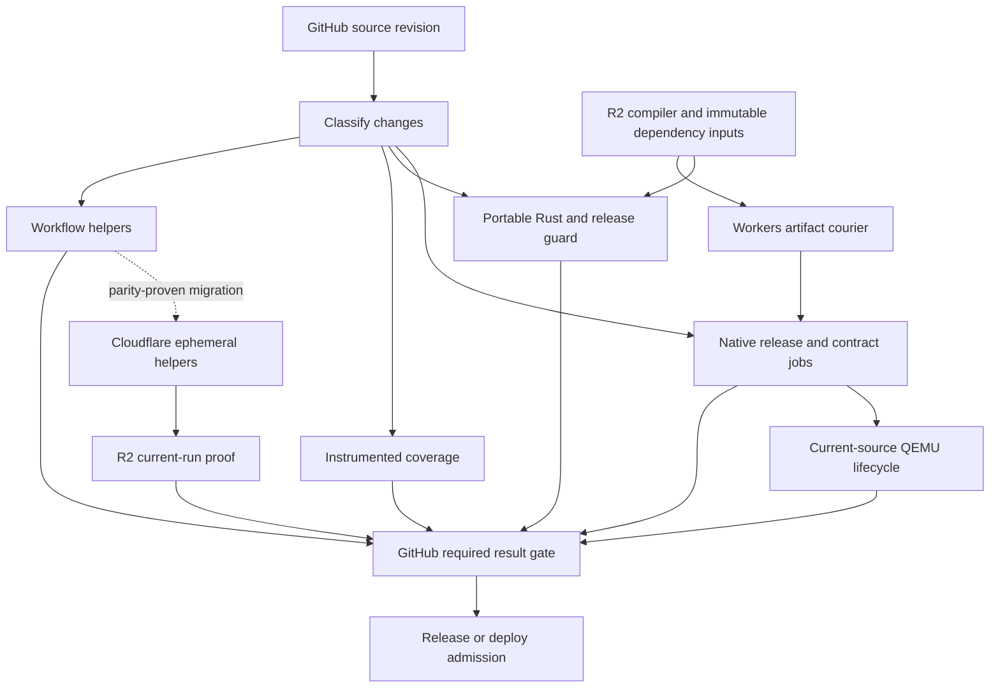

# GitHub and Cloudflare CI research and implementation plan

Reviewed November 10, 2026, America/Chicago. Repository baseline is `67678badc17e1c223b71cc3c35f1506c931cc636`. The reviewed Cloudflare CI SDK is `@cloudflare/ci` 0.2.0 at `fbbc2902c07c8ac89612f915f28c58c9b0941dbd`. This document governs the next CI changes. Earlier October agent-automation documents describe historical deployments.

## Objective and completion conditions

Reduce elapsed time from a GitHub commit or PR update to all required successful checks to six or seven minutes. Record cold and warm results separately. The target includes queue time, coverage and native acceptance. A fast benchmark job alone cannot establish the target.

Use the existing checkout on C:, GitHub's available standard runners and Cloudflare Startup credits. Keep the coding agent local. Review tests encountered during this work. QEMU retirement requires equivalent replacement execution for each affected contract.

The earlier research missed the official Cloudflare CI SDK. This review covers its documentation, pinned implementation, dependencies, examples and compatibility with OMG. Every proposed implementation below has an entry check and an acceptance check.

## Current execution and measured delays

The checked-in pipeline builds on GitHub. `services/ci` is an optional plain Ubuntu Cloudflare runtime pilot. The retired issue-repair agents have separate historical configuration. The pilot uses a source-specific image, which adds build and rollout time to each attempt. [Current CI source](https://github.com/omg-cli/omg/blob/67678badc17e1c223b71cc3c35f1506c931cc636/.github/workflows/ci.yml), [pilot workflow](https://github.com/omg-cli/omg/blob/67678badc17e1c223b71cc3c35f1506c931cc636/.github/workflows/cloudflare-native-ci.yml), [pilot evidence](../benchmarks/cloudflare-runtime-pilot-2026-11-10.json)

| Measurement | Observed result | Interpretation |
| --- | --- | --- |
| Main CI at `574e7d6c`, run `42939262587` | Required CI Success at 35m21s after workflow creation. Entire workflow 35m32s. | Successful complete baseline. |
| Exact same main coverage, run `42939262354` | 10m56s elapsed, successful. | Coverage runs alongside CI. |
| Matched isolated R2 diagnostic, run `42925029452`, attempts 1 and 2 | 31m40s cold, 18m37s warm. Portable Rust 30m38s to 11m26s. | Same source and cache prefix. This diagnostic excludes QEMU. |
| Same R2 diagnostic counters | Warm 6,782 hits out of 6,798 cacheable compilations. Zero cache read or write errors in both attempts. | Real cache benefit with a remaining execution and linking cost. |
| Fedora full RPM comparison, successful run `42939989971` | Two CPUs 18m23s. Four CPUs 12m35s. Both complete bundles admitted. | One matched pair. Earlier pair improved by only 83s, so variability matters. |
| Ubuntu QEMU lifecycle at successful main `574e7d6c` | Lifecycle step 715s. | This single required step already exceeds seven minutes. |
| Workflow checks at `67678bad`, run `42944756099` | `make ci-workflow-quick` 530s. Its 1,515 script tests consumed 461.479s. Release-smoke fixture approximately 51.4s. | Profile and divide independent helper suites before changing their selection. |
| Portable release guard in PR run `42944845165` | 499s. | A release-mode Rust test build is another complete-gate constraint. |
| Cloudflare Ubuntu pilot at `b58aba89` | Full job 19m16s. Hosted runtime step 32s. | The two selected tests and catalogue recipe passed. Full pipeline speed remains unproven. |
| Cloudflare release compilation trial | Both binaries failed to finish within 1,200s on standard-4. | Provider migration alone has no demonstrated compiler speed advantage. |

Sources are the [successful complete CI](https://github.com/omg-cli/omg/actions/runs/42939262587), [paired coverage](https://github.com/omg-cli/omg/actions/runs/42939262354), [R2 pair](https://github.com/omg-cli/omg/actions/runs/42925029452), [successful CPU comparison](https://github.com/omg-cli/omg/actions/runs/42939989971), [current main CI](https://github.com/omg-cli/omg/actions/runs/42944756099), [PR CI](https://github.com/omg-cli/omg/actions/runs/42944845165), and [Cloudflare compilation receipt](../benchmarks/cloudflare-release-build-limit-2026-11-10.json). Samples from different sources or hosts are separate observations.

Main coverage at `67678bad` initially failed because LLVM exported a saturated derived counter at `src/hooks/mod.rs:468`. The error arm had count zero while its return region had count one. The comparison rejected the result. The first failure's reports and logs were preserved before rerunning the instrumented producer. The second attempt's tests passed, then artifact admission failed because the run contained two `coverage-lcov` artifacts. This exposes a separate rerun-identity gap. Raw profile diagnostics are still required to establish the counter failure's cause. [First attempt](https://github.com/omg-cli/omg/actions/runs/42944755869/attempts/1), [second attempt](https://github.com/omg-cli/omg/actions/runs/42944755869/attempts/2)

## Cloudflare has several distinct CI integration paths

| Path | Actual capability | Fit for OMG |
| --- | --- | --- |
| GitHub Actions deploying through Wrangler | GitHub runs commands and supplies a scoped deployment token. | Existing deployment path and simplest authority for merge and release. |
| Workers Builds connected to GitHub | Managed build and Worker deployment on push. Current limit is 20 minutes, four CPUs and 8 GB on Paid, with six concurrent builds. | Suitable for Worker control-plane deployment. Validate Rust commands and caching before assigning native build work. |
| Cloudflare CI SDK | A Worker Workflow runs parallel sandbox commands and caches dependency snapshots. Artifacts push events can trigger it directly. | Useful orchestration. Version compatibility and OMG's source, test, cleanup and provenance contracts require explicit adaptation. |
| Ephemeral GitHub runner in a Cloudflare Container | The normal GitHub job executes in a per-job Cloudflare VM through a runner integration. | Potentially preserves YAML, job IDs and GitHub reporting while adding compute outside hosted-runner slots. Requires runner and Docker compatibility proof. |
| GitHub with Cloudflare cache and artifact services | GitHub executes native jobs while R2, Workers and the registry distribute reusable inputs. | Chosen immediate integration. It addresses measured repeated work with the smallest change to acceptance. |

The documented [Wrangler integration](https://developers.cloudflare.com/workers/ci-cd/external-cicd/github-actions/), [Workers Builds limits](https://developers.cloudflare.com/workers/ci-cd/builds/limits-and-pricing/), [official CI guide](https://developers.cloudflare.com/artifacts/guides/build-and-deploy-on-push/), and [Cloudflare CI announcement](https://blog.cloudflare.com/ci-workflows/) describe different execution paths. The Artifacts-first CI SDK runs atop Workflows and Sandbox.

## Official CI SDK compatibility

Cloudflare CI 0.2.0 is a real published package. Its core uses Workflows and Sandbox. The optional self-healing example owns the AI integrations. The plain core can run ordinary commands without an AI model. The package exports TypeScript for Workers-aware bundlers and requires `nodejs_compat` for its Worker entrypoint. [Pinned package](https://github.com/cloudflare/ci/blob/fbbc2902c07c8ac89612f915f28c58c9b0941dbd/package.json), [pinned README](https://github.com/cloudflare/ci/blob/fbbc2902c07c8ac89612f915f28c58c9b0941dbd/README.md)

| Verified implementation detail | Required adaptation before adoption |
| --- | --- |
| Version 0.2.0 pins Sandbox 0.12.1. | Pin an actual compatible SDK and image pair. Test its Wrangler configuration against the current scheduling generation. |
| Its example package can still resolve CI 0.1.0. | Verify the installed lockfile version and deployed bundle identity. |
| The shipped source adapter is Artifacts-first. | Specify GitHub-to-Workflow dispatch and result admission, or an authenticated exact-source mirror. |
| Snapshot cache covers `/workspace`. | Put reusable Cargo inputs in an explicit cached directory. Preserve installed OS dependencies through a compatible base image, verified RPM bundle, or full-filesystem snapshot. |
| Checkout overlays the restored source and leaves deleted files. | A source-deletion and rename fault must pass. Reconcile the checkout against the exact source tree while preserving only declared dependency output. |
| A cache hit skips the cached command. | Cache installation and compilation inputs. Run current application tests. Record explicitly admitted historical dependency checks under their original build identity. |
| The key includes repository, command, environment and selected input blobs. | Include image digest, architecture, compiler, feature set, build profile and relevant dependency closure in declared inputs. |
| Source checkout excludes `.git`. | Supply verified source identity and adapt commands that currently obtain it from Git. |
| Default retry settings can rerun a failed command. | Set test retries explicitly to preserve the original first-failure result. Separate bounded transport retries from test results. |
| Raw command logs can contain secrets. | Keep cloud and GitHub write credentials in the trusted controller. Store bounded, access-controlled logs and redact displayed diagnostics. |
| Cleanup and failure output differ from OMG's current controller. | Execute failure, timeout and cancellation controls. Require complete evidence and provider-confirmed destruction. |

These findings come from the pinned [sandbox runner](https://github.com/cloudflare/ci/blob/fbbc2902c07c8ac89612f915f28c58c9b0941dbd/src/ci/runners/sandbox.ts), [cache implementation](https://github.com/cloudflare/ci/blob/fbbc2902c07c8ac89612f915f28c58c9b0941dbd/src/ci/cache.ts), and [pipeline types](https://github.com/cloudflare/ci/blob/fbbc2902c07c8ac89612f915f28c58c9b0941dbd/src/pipeline/types.ts). Adoption requires passing those controls with the chosen version.

Current native Container snapshots save the writable root filesystem, including installed RPM state. Separately mounted filesystems, memory and running processes are excluded. Snapshots use the `durable_object` scheduling policy and remain tied to the original image. Their 30-day retention refreshes on restore. The application must enforce its own build-age policy. This native API is separate from CI SDK 0.2.0's directory backups. [Native snapshots](https://developers.cloudflare.com/containers/guides/snapshots/), [Sandbox directory backups](https://developers.cloudflare.com/sandbox/reference/directory-backups/)

The `default` scheduling policy was deprecated November 4. Migration creates a replacement application and namespace. Under `durable_object`, a nonzero execution UID still receives root capabilities. Verify protected-file denial, irreversible privilege reduction and descendant behavior in the replacement. Run a new teardown canary. [Scheduling policies](https://developers.cloudflare.com/containers/configuration/scheduling-policy/), [migration procedure](https://developers.cloudflare.com/containers/guides/migrate-to-durable-object-scheduling-policy/), [native execution capabilities](https://developers.cloudflare.com/containers/api/durable-object-container/#exec)

## Ephemeral GitHub runners on Cloudflare

SuperCI is an MIT-licensed implementation with a Cloudflare control plane and ephemeral Cloudflare GitHub runners. AWS is optional. Reviewed version 0.20.3 is `f109f80ffcced2625d5239034c07096a06cbf830`. It is the first runner-integration candidate for the trusted helper pilot because it preserves GitHub's normal execution and reporting model. [Project source](https://github.com/supercorp-ai/superci/tree/f109f80ffcced2625d5239034c07096a06cbf830), [Cloudflare provider](https://superci.dev/docs/providers)

| Source-verified behavior | OMG pilot condition |
| --- | --- |
| The organization App requests runner management, Actions write and metadata read. | Use a dedicated installation limited to OMG. Keep the App key in the control plane. |
| One JIT runner handles one matching queued job. | Verify the actual GitHub job identity through existing source, run, attempt and artifact admission. |
| Public repositories require an allowlist. Fork PRs and `pull_request_target` are refused. | Route forks to standard GitHub-hosted execution before dispatch. Run a real refusal canary. |
| Refusal handling appears to mark internal failure without invoking the normal failure runner. | Verify that GitHub receives a terminal failed result. This is a source prediction awaiting execution. |
| Cloudflare capacity is Linux x64, four CPUs, 12 GiB and 20 GB. | Start with two bounded independent helper shards. Measure resource use and cold tool setup. |
| Named custom runner images are currently Modal-only. | Validate the supplied runner and ordinary pinned `job.container` images. A custom Cloudflare runner image requires an implementation change. |
| Its Docker wrapper converts runner networks to host networking. | Execute service, socket, ordinary-user, namespace and cancellation controls for each selected job. |
| Completion handling and an independent timeout alarm stop instances. | Confirm destruction after success, failure, cancellation, duplicate webhook and controller restart. |

The reviewed [App manifest](https://github.com/supercorp-ai/superci/blob/f109f80ffcced2625d5239034c07096a06cbf830/crates/core/src/github.rs), [runner environment](https://github.com/supercorp-ai/superci/blob/f109f80ffcced2625d5239034c07096a06cbf830/crates/runners-cloudflare/src/job_runner.rs), [Docker wrapper](https://github.com/supercorp-ai/superci/blob/f109f80ffcced2625d5239034c07096a06cbf830/crates/core/src/docker.rs), and [policy controller](https://github.com/supercorp-ai/superci/blob/f109f80ffcced2625d5239034c07096a06cbf830/crates/core/src/plane.rs) establish these implementation details. They establish eligibility for a pilot, with hosted acceptance still pending.

## Service selection and credit budget

The active dashboard readback during this work showed a $10,000 award balance and an October 6, 2027 expiry. The public policy covers most compute, storage and Developer Platform usage. It explicitly lists Workers, Durable Objects, Workflows, R2, Queues, KV and D1. The R2 ceiling shares the award balance. Containers and Artifacts have documented usage charges and broad policy support. Their account-specific invoice deductions have yet to be observed. [Startup terms](https://www.cloudflare.com/startups/), [Containers pricing](https://developers.cloudflare.com/containers/platform/pricing/), [Artifacts pricing](https://developers.cloudflare.com/artifacts/platform/pricing/)

| Service | CI role and decision |
| --- | --- |
| R2 | Compiler objects, immutable dependency bundles, closed evidence archives and snapshot backing. Apply lifecycle rules by data class. |
| Workers | Narrow artifact courier, optional short-lived read credential broker and authenticated dispatch. Stream large objects. |
| Workflows | Durable Cloudflare job lifecycle, bounded transport retries, status and cleanup. Keep large logs in R2 and return compact receipts. |
| Durable Objects | Per-run ownership and lifecycle. Reuse the chosen runner's controller where possible. |
| Containers and managed OCI registry | Reusable digest-pinned toolchain and distro images, then disposable Linux execution after parity tests. |
| Artifacts | Exact-source mirror and direct SDK event integration if that path earns adoption. Current GitHub checkout takes seconds, so measure the additional mirror and trigger costs. |
| Workers Cache and CDN | Serve immutable, content-addressed courier objects after verifying cache isolation and size limits. Keep mutable selection and authorization responses fresh. |
| Queues | Add only if dispatch buffering or completion events need durable decoupling beyond the selected Workflow. |
| D1 or Analytics Engine | Optional historical timing and reliability queries once compact run receipts identify a reporting need. |
| KV | Optional disposable lookup data. Artifact admission requires strong source and digest evidence independent of a cached lookup. |
| Cache Reserve and Argo | Evaluate only against a measured transfer bottleneck and supported request path. |

Workers Builds' automatic package cache documents JavaScript package-manager directories and a 10 GB project limit. Cargo caching requires an explicit proven path. Workers Cache accelerates HTTP responses and bills standard Worker requests. R2-backed sccache remains the compiler-cache mechanism. [Build caching](https://developers.cloudflare.com/workers/ci-cd/builds/build-caching/), [Workers Cache](https://developers.cloudflare.com/workers/cache/), [sccache R2 configuration](https://github.com/mozilla/sccache/blob/v0.18.0/docs/S3.md)

Artifacts is Git-backed source storage. Its current limits include 32 MiB per file, 64 MiB per push and 1 GB for a new repository. Store larger compiler and runtime archives in R2 or the OCI registry. The current pricing page says Artifacts usage billing starts November 12, 2026. This supersedes the billing-date assumption in the October review. [Artifacts limits](https://developers.cloudflare.com/artifacts/platform/limits/), [current pricing](https://developers.cloudflare.com/artifacts/platform/pricing/)

Use existing subscribed services within the observed award. Start new compute trials with at most two concurrent instances, a 15-minute lifetime and one diagnostic wave. Record resource-seconds, storage growth, remaining award and expiry. At current published resource rates, one standard-4 instance fully using four CPUs for ten minutes is approximately $0.06684 before included allowances, network and controller charges. Usage ceilings bound consumption. Provider invoice application remains a separate observation. [Resource rates](https://developers.cloudflare.com/containers/platform/pricing/)

The selected pipeline contains ordinary build and test execution. Workers AI and AI Gateway have no role. The user requires all CI expansion to stay within the Startup award.

## GitHub credentials and trust boundaries

Existing repository cache secrets are `OMG_R2_CACHE_ACCESS_KEY_ID` and `OMG_R2_CACHE_SECRET_ACCESS_KEY`. Repository variables provide the account ID and opt-in. The production environment already has `CLOUDFLARE_ACCOUNT_ID` and `CLOUDFLARE_API_TOKEN`. The plain pilot has `OMG_NATIVE_CI_TOKEN`. Verify names and scopes through metadata and actual probes. Keep secret values out of logs and receipts. [Cloudflare deployment setup](https://developers.cloudflare.com/workers/ci-cd/external-cicd/github-actions/), [R2 token scope](https://developers.cloudflare.com/r2/api/tokens/)

Trusted main publication can use bucket-scoped writes. Public fork consumers can read curated, verified dependency bundles through a GET/HEAD-only Worker. Limit that Worker to the dependency namespace. Private compiler objects and evidence stay private.

Same-repository PR compiler caching can use GitHub OIDC and short-lived read-only R2 credentials. Bind issuer, audience, immutable repository and owner IDs, workflow identity, event and ref. A job name is insufficient identity. External-fork OIDC availability needs a real canary. Retain the GitHub-hosted cold path wherever credentials are unavailable. [GitHub OIDC claims](https://docs.github.com/en/actions/reference/security/oidc), [R2 temporary credentials](https://developers.cloudflare.com/r2/api/s3/temporary-credentials/)

Every artifact receipt binds source SHA, producer run and attempt, consumer run and attempt, architecture, OS image, ABI recipe and file digests. A reused dependency keeps its original build identity. Current application tests record their own identity. Verify GitHub provenance against the expected repository and workflow before admission. [GitHub artifact attestations](https://docs.github.com/en/actions/how-tos/secure-your-work/use-artifact-attestations/use-artifact-attestations), [attestation verification](https://cli.github.com/manual/gh_attestation_verify)

R2 publication writes immutable archive and proof objects first. Publish the selection pointer last with conditional writes. Reject missing, stale or mismatched objects. Keep real source-build completion time distinct from upload or signature time. R2 provides strong consistency and conditional operations. [Consistency](https://developers.cloudflare.com/r2/reference/consistency/), [conditional writes](https://developers.cloudflare.com/r2/api/s3/conditional-operations/)

### Dependency reuse admission contract

Selection uses the SQLite dependency source and recipe closure, toolchain, pinned image, architecture and installed dependency inventory. The current OMG consumer commit has its own receipt. Demonstrate dependency build A consumed by application commit B while preserving A's manifest and original source identity.

Choose fresh per-consumer dependency resolution. Run the consumer's authenticated DNF transaction before looking up a bundle. Bind actual installed RPM immutable-header or strong payload hashes and verified signer identities. Include the relevant runtime ABI. Probe the chosen RPM query on the pinned Fedora image. Unsupported or incomplete inventory takes the full cold path. Publish refreshes from trusted main nightly and when dependency recipe inputs change. A delayed or missing scheduled run still leaves the age and inventory checks enforced. [DNF configuration](https://dnf5.readthedocs.io/en/latest/dnf5.conf.5.html), [GitHub schedule behavior](https://docs.github.com/en/actions/reference/workflows-and-actions/events-that-trigger-workflows#schedule)

Attestation admission verifies subject digest, expected predicate shape, immutable repository and owner IDs, trusted publisher workflow, ref and source SHA. Local-bundle verification can still retrieve authenticated TUF roots. It uses the verifier's trusted roots. [Attestation verification behavior](https://cli.github.com/manual/gh_attestation_verify)

The proposed maximum age is 24 hours at every installation admission. Require actual source-build completion at or before the verified transparency-log timestamp, with both at or before current time. Publication retries, signatures and snapshot restores preserve the original completion time. If the bundle expires before a later installation, run the full cold producer and issue a new admission receipt.

Bind original manifest digest, admission digest and current source, run and attempt through every before, after, final, native-install and Fedora-guest consumer. Preserve the existing same-source cold manifest path. Report historical dependency checks as reused and current application tests as executed.

A publisher writes immutable archive and attestation objects, verifies readback, then conditionally updates a monotonic build-generation pointer. Compare generations after each conditional-write conflict so a delayed older publisher cannot replace a newer result. Bound archive size, member count and expansion. Reject traversal, links escaping the destination, malformed archives, partial transfers and extraction failures. Preserve their diagnostic receipt before the full cold fallback. The cold producer retains its original failure result, timeout and resource limits.

Dependency snapshots exclude current application source, credentials, raw profiles, coverage reports, JUnit, PID files and prior admission receipts. Create current-run evidence in new owned directories after restoring dependencies.

Run mutable package databases, SQLite WAL, Cargo target directories and coverage profiles on the instance's local filesystem. Upload closed archives to R2. R2 mounts have different locking, permissions, link and metadata-cache behavior. [S3Mount filesystem behavior](https://developers.cloudflare.com/sandbox/reference/s3-mounts/#mounted-file-behavior)

## Workload placement and replacement proof

| Workload | Initial placement | Proof before moving or reusing work |
| --- | --- | --- |
| Workflow helpers and shell fixtures | GitHub, then bounded Cloudflare helper pilot | Same discovered test identities, all assertion controls, source deletion, ordinary UID, timeout and cleanup. Profile the 1,515-test suite before sharding it. |
| Portable Rust compilation and release guard | GitHub with R2 and existing Cargo caches | Same compiler, features, release settings and actual tests. Validate clean cache writes and replay. |
| Native Arch, Debian 12, Debian Trixie, Ubuntu 24.04, Ubuntu 26.04 and Fedora | Existing GitHub distro lanes | Matching package ABI, image identity, libtest and nextest selections, hooks, ignored integrations and package catalogue receipts. |
| Fedora SQLite supply | Trusted producer with a reusable verified dependency bundle | Original full source and binary RPM checks, dependency inventory, actual build age and provenance. Run current application and guest checks against admitted bits. |
| QEMU boot, reboot, services, package transactions and guest lifecycle | Existing KVM-capable GitHub lanes | Execute every corresponding contract and fault in a replacement. Default Cloudflare Linux execution establishes only its own environment. |
| ARM64 native and guest execution | Existing ARM-capable routes | Real architecture execution and ABI proof. An amd64 image cannot establish ARM behavior. |
| macOS and Windows | Existing native routes | Actual operating-system execution. |
| LLVM coverage | Existing instrumented GitHub producer | Valid raw counters, matching object mapping and exact-source comparison. Preserve killed-descendant coverage. |
| Worker deployment and smoke checks | GitHub with Wrangler, optionally Workers Builds | Deployed version, image digest, binding readback, actual smoke and teardown. |

Cloudflare Containers currently document `linux/amd64` images in isolated microVMs. Docker-in-Docker has networking restrictions. Full KVM access, guest boot parity and arbitrary native architectures require explicit execution evidence. [Container lifecycle](https://developers.cloudflare.com/containers/concepts/architecture/), [Docker support](https://developers.cloudflare.com/containers/faq/)

## Chosen architecture

Keep GitHub as source, required-check and release authority. Expand Cloudflare first through R2 artifact reuse and a narrow Workers courier. Use Workflows and a bounded ephemeral compute pilot for the expensive independent helper work. Select its GitHub runner integration after the compatibility controls below. Promote one workload at a time with its original acceptance still running during comparison.

The organization currently reports GitHub Free. Its documented standard hosted-runner concurrency limit is 20. The private release-producer extraction proposal raises the initially runnable CI jobs from 16 to 21 before other workflows. Queue measurement and a capacity plan are prerequisites to adopting that graph. A job split can move a bottleneck into the runner queue. [GitHub Actions limits](https://docs.github.com/en/actions/reference/limits)

The preferred Cloudflare compute canary is the independent workflow-helper suite. It avoids making another full Rust image build the first experiment. Compare a reusable tool image against the source-specific pilot image. Include current source as an immutable input and verify the entire file set before execution.

The official SDK remains a candidate with the adaptation checklist above. An established ephemeral GitHub runner is a second candidate because it can preserve existing YAML and result handling. Decide from actual job-container, UID, network, cancellation and teardown controls. Keep one selected compute controller after comparison.

## Implementation sequence

| Stage | Entry evidence and bounded change | Acceptance and next action |
| --- | --- | --- |
| 0. Establish valid baseline | Preserve the failed coverage inputs. Repair artifact selection and downloading with exact producer-attempt admission. Add early region validation and failure-only raw profile diagnostics using the existing strict parser. | Reject mixed attempts, duplicate same-attempt artifacts, wrong owner and incomplete listings. Support report-only and producer reruns. Reproduce or localize the invalid expression. Compare valid exact-base and head evidence under one recipe. |
| 1. Measure the whole graph | Capture workflow creation, queue, start and finish times, per-step durations, helper-module timings, test identity sets, cache statistics and resource use. | One successful cold and one warm baseline at the same source, with individual and aggregate results. Use the successful 35m21s run as historical evidence. |
| 2. Finish the reviewed cache slice | Revalidate PR #1054 against the current base. It adds Benchmark R2, four-CPU Fedora quota and separate Fedora guest scheduling. | Exact CI and coverage, all five required x86 guests, then trusted-main cold and warm Benchmark runs with zero cache read and write errors. |
| 3. Prove helper partition and compute | Divide independent helper modules using measured durations and isolated scratch. Compare a bounded Cloudflare reusable-image pilot with the original GitHub suite. | Equal discovered and executed test sets. Missing, duplicated, failed or timed-out cases fail admission. Record queue time, complete logs, cleanup and Startup consumption. |
| 4. Reuse the Fedora dependency build | Implement the dependency admission contract above. Prove the courier, trusted publisher, consumer admission and every install caller in that order. | Demonstrate A-to-B reuse and a full cold miss. Reject wrong closure, signer, source identity, timestamp, generation and archive. Verify complete Fedora native and guest proof. |
| 5. Advance native artifact readiness | Evaluate the sealed producer-extraction proposal with a runner budget. Keep the release producer identities and all independent contracts required. | Native artifact admission, partial reruns, cancellation, ABI and source proof remain valid. Demonstrate earlier guest start without increased total queue time. |
| 6. Optimize remaining long executions | Profile portable release linking, coverage, macOS, helper outliers and QEMU phase time. Reuse sealed preparation where its recipe and dependency identity match. | One measured improvement per change. Current tests and fault controls remain successful. Expand Cloudflare execution only for contracts already proven there. |
| 7. Accept the complete system | Run the same committed source cold and warm, then repeat representative Rust, dependency and workflow-only changes. | Meet the target with all required gates. Publish failures, medians, ranges, queue time and costs. Retire superseded branches and scratch after main verification. |

Each implementation commit records the stage, source evidence, expected effect, failing control, verification command and measured result in this document or its linked receipt. Update the plan when an observation changes the selected design before changing production behavior.

Stages 3 and 4 are independent after stage 2. The helper compute pilot can proceed alongside dependency transport validation. Promote each completed slice only after its own acceptance checks.

Before a local native wave, apply AGENTS.md's host-volume and per-distro admission budgets. Keep at least 20 GiB free on the Windows backing volume. Budget expected guest growth against 100 GB, monitor the run, and assign every temporary target an owner and retirement condition. Retire superseded generated output after verified main acceptance while preserving authored and unresolved work.

### Source changes by stage

| Stage | Existing entrypoints and consumers to review together |
| --- | --- |
| Coverage admission and diagnostics | `.github/workflows/coverage.yml`, `scripts/require-base-coverage.py`, `scripts/check-line-coverage.py`, `scripts/test_base_coverage.py`, `scripts/test_line_coverage.py`, `scripts/test_ci_optimization.py` |
| Cache and guest scheduling | PR #1054's Benchmark, Fedora supply, CI and reusable QEMU workflows, final gate fixtures and QEMU failure reporter |
| Helper profiling and sharding | `Makefile` target `ci-workflow-quick`, selected Python discovery entrypoints, `.github/workflows/ci.yml`, strict final result gate and all its executable fixtures |
| Dependency reuse | Fedora supply workflow and build/verifier scripts, native install admission, before/after/final package checks, Fedora guest consumer, curated Worker and tests |
| Compute pilot | Existing `services/ci` courier and proof contracts, chosen runner controller, pinned image setup, event routing and lifecycle fault fixtures |
| Producer extraction | Native matrix and Ubuntu jobs, Clippy and sandbox consumers, native artifact ownership, runtime usage and final gate fixtures |

Reuse the existing verifiers and data formats when their invariants fit. Keep new transport and admission logic at the service boundary. A new helper must have an executed behavior test through its normal entrypoint.

## Benchmark and promotion protocol

Measure commit-to-required-check completion on one exact source revision. Include all required workflows and terminal result gates. Report event-to-job queue time separately from job execution, artifact transfer, setup, build, test and cleanup.

An empty disposable cache namespace establishes cold cache behavior. A rerun at the same source and namespace establishes warm behavior. Capture digest-verified artifacts before rerunning because GitHub can replace attempt artifacts. Keep only one full diagnostic wave active for the controlled comparison.

Require equal current application and guest test selections, actual execution and valid current-run receipts. Compare reused dependency proof separately against the complete original dependency suite and admission contract. Include a failing test, absent artifact, wrong source, changed dependency, cache outage, timeout and cancellation. A transport retry preserves the first test outcome. A failed teardown fails the pilot's acceptance.

After the matched pair, collect at least five successful warm samples and representative source changes. Report median, range, failures and first-attempt success. A six-to-seven-minute result is accepted only with all required checks completed inside that interval. Cold recovery has its own measured result and stated bound.

## Current checkpoint and unresolved proof

- PR #1054's cache and scheduling revision `55f8ffb4` passed CI and coverage. The reviewed stage 0 fix and this plan are being added to that PR for one combined hosted verification wave. Its R2 Benchmark production path still needs trusted-main cold and warm proof. [PR #1054](https://github.com/omg-cli/omg/pull/1054)
- The native producer-extraction patch is sealed privately and remains unapplied. Its expanded job graph needs a capacity experiment.
- The dependency-reuse prototype is incomplete and remains private. The research replaces assumptions about snapshot scope and identifies which provenance checks the application must still supply.
- The SDK version, cache semantics and scheduling-generation gaps are source-verified. OMG runtime parity for the proposed replacement is unverified.
- The existing Ubuntu pilot proves two named libtests and its package-catalogue recipe. Full native suites, ARM and QEMU replacement are pending.
- Raw LLVM failure inputs were unavailable in the first failed artifact set. The saturated counter is evidence of an inconsistent derived region. Its originating process and collection defect remain unresolved.
- Containers and Artifacts invoice deductions and the final multi-service credit consumption remain unobserved. Keep the observed award balance, usage receipts and invoice application in the execution record.

## Execution record

| Step | Completed evidence | Remaining acceptance |
| --- | --- | --- |
| Research | Published plan, pinned primary sources, independent architecture reviews and repository documentation audit. | Update the plan when measured behavior changes a decision. |
| Baseline recovery | Main `67678bad` CI and coverage are successful. Attempt 2 reports passed the complete source-aware comparison. Two redundant first-attempt standalone copies were retired after proving byte equality with retained failed comparison artifact `13823091231`. | The original counter defect still needs raw-profile diagnosis. |
| Stage 0 implementation | Producer-owned report selection, immutable-ID download, digest and size verification, attempt-qualified uploads and failure-only raw diagnostics. The focused Linux suites passed 186 tests. Windows base coverage passed 25. Independent review caught clock-dependent ZIP metadata and colored command-log parsing. Both received failing controls and verified corrections. | Complete combined hosted CI, qualified-upload admission and a report-only rerun. |

The stage 0 code is combined with the existing reviewed cache slice to avoid a second full CI wave for independent changes. Each slice retains its acceptance conditions. The combined head needs its own terminal checks and independent review.
